<style>
  .main-content { max-width: 90% !important; padding-left: 2rem !important; padding-right: 2rem !important; }
</style>
<!-- Generated by XLBench. Do not edit by hand; re-run scripts/run-benchmarks.ps1. -->
# XLBench Results

Each section below embeds the full BenchmarkDotNet environment block (OS, CPU,
.NET SDK and runtime). Timings are hardware-specific; treat the allocation/GC
columns as the most portable signal across machines. Regenerate locally with
`scripts/run-benchmarks.ps1`.

> ⚠️ Generated on a shared GitHub Actions runner — timings are indicative and vary run to run; allocation/memory figures are reliable. Authoritative timings come from a local run: [results.html](results.html).

📈 **[Interactive charts](charts.html)** (GitHub Pages). Static charts and the full tables follow.

Each results table (one per test method) is heat-mapped independently on the Pages site (🟩 best → 🟥 worst).

> ⧗ **Carried over from an earlier run.** The rows and chart points below marked with this symbol were not measured here — the library is commercial and needs a licence key this run did not have — so they are replayed from `snapshots/`. Compare them as indicative rather than like-for-like, and see the repository README for how to refresh a snapshot.
>
> - **IronXL** 2026.8.1, Job-HTCPYF job, captured 2026-08-03 on different hardware — Windows 11 (10.0.22631.6199/23H2/2023Update/SunValley3), AMD Ryzen 9 5950X 16-Core Processor.

## Libraries under test

| Library | Version | Source |
| --- | --- | --- |
| ClosedXML | 0.105.1 | this run |
| EPPlus | 8.7.1 | this run |
| OpenXML SDK | 3.5.1 | this run |
| NPOI | 2.8.1 | this run |
| MiniExcel | 1.46.0 | this run |
| Sylvan | 0.5.8 | this run |
| XLibur | 0.700.0 | this run |
| OfficeIMO | 3.4.5 | this run |
| IronXL ⧗ | 2026.8.1 | snapshot (2026.8.1, Job-HTCPYF, captured 2026-08-03) |

## Comparison charts

_Lower is better. Charts render in the GitHub file view; the Pages site has interactive versions._

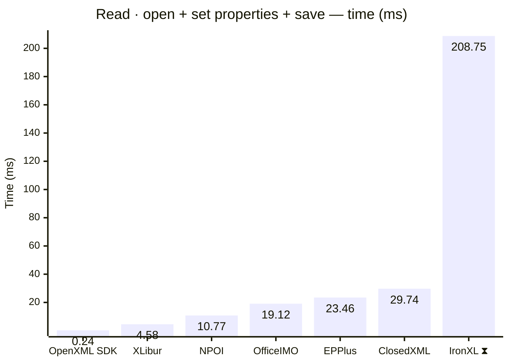

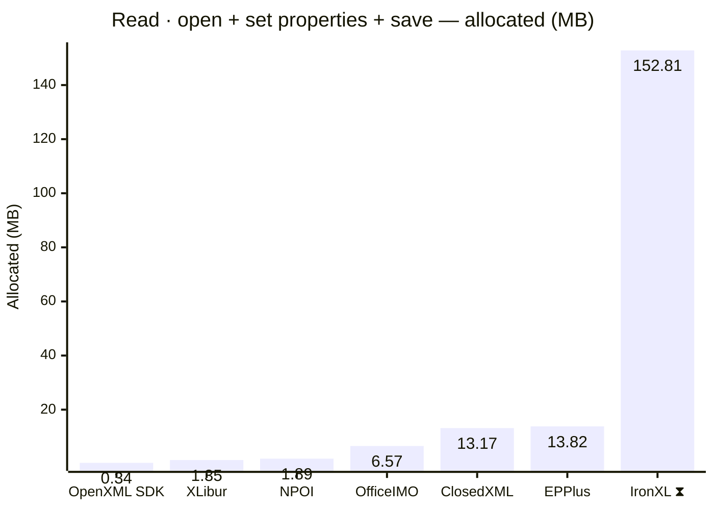

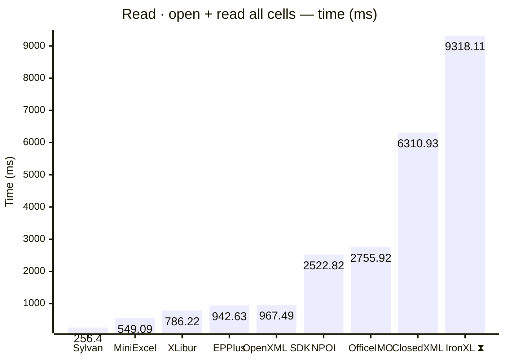

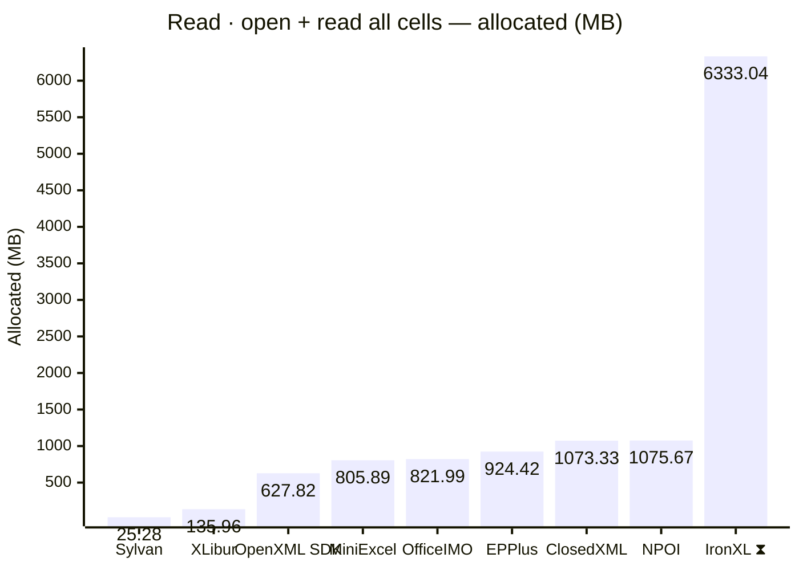

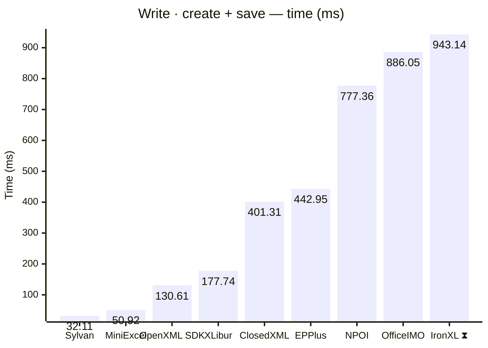

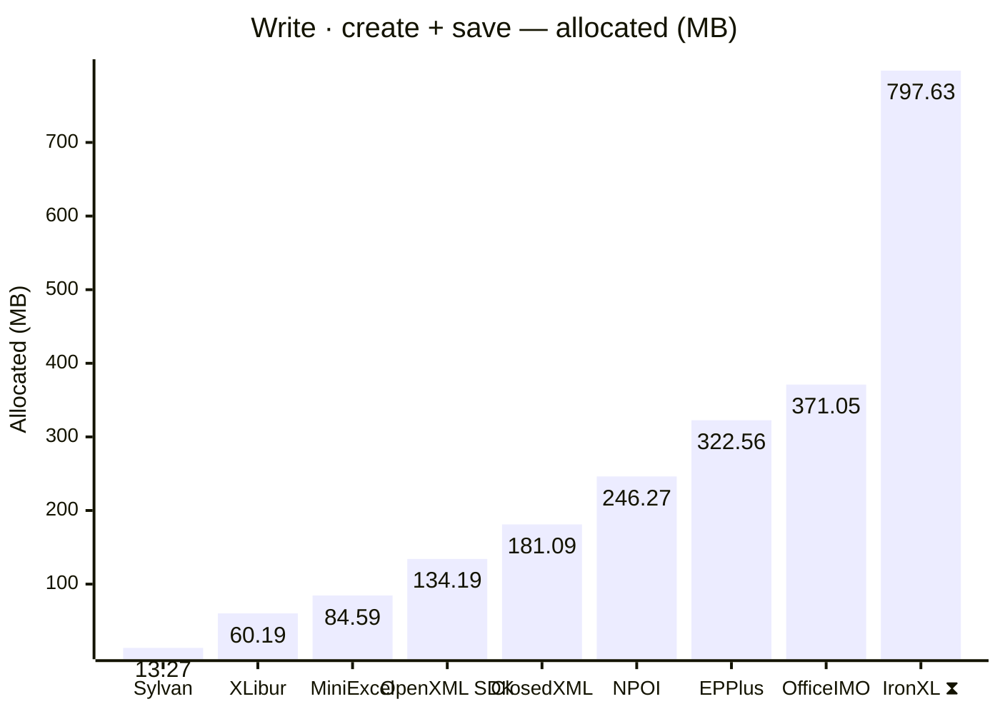

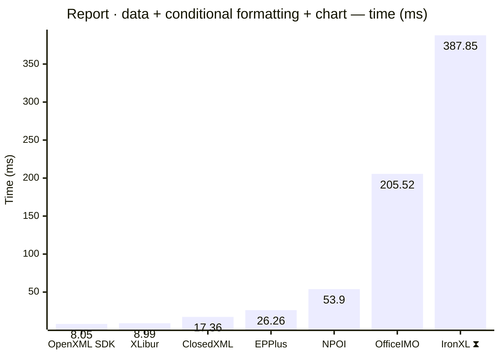


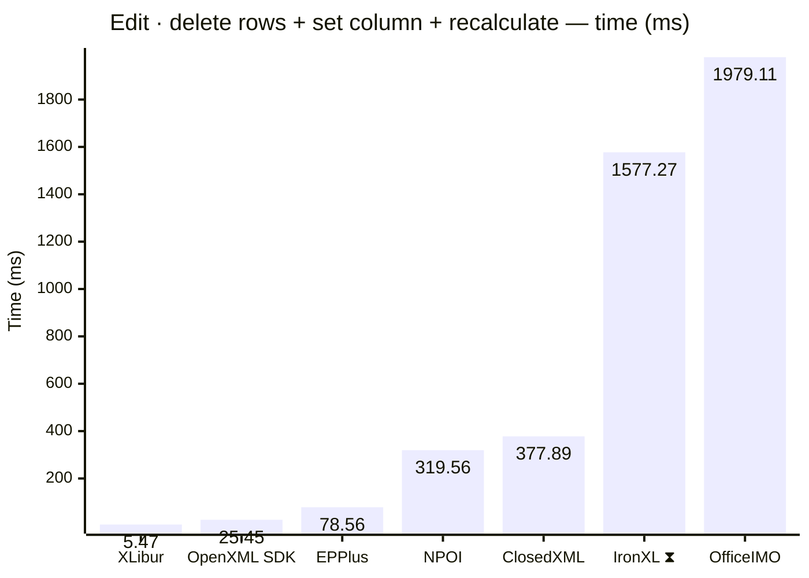

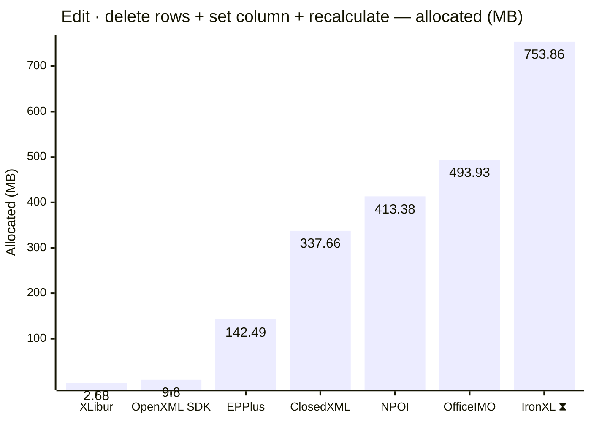

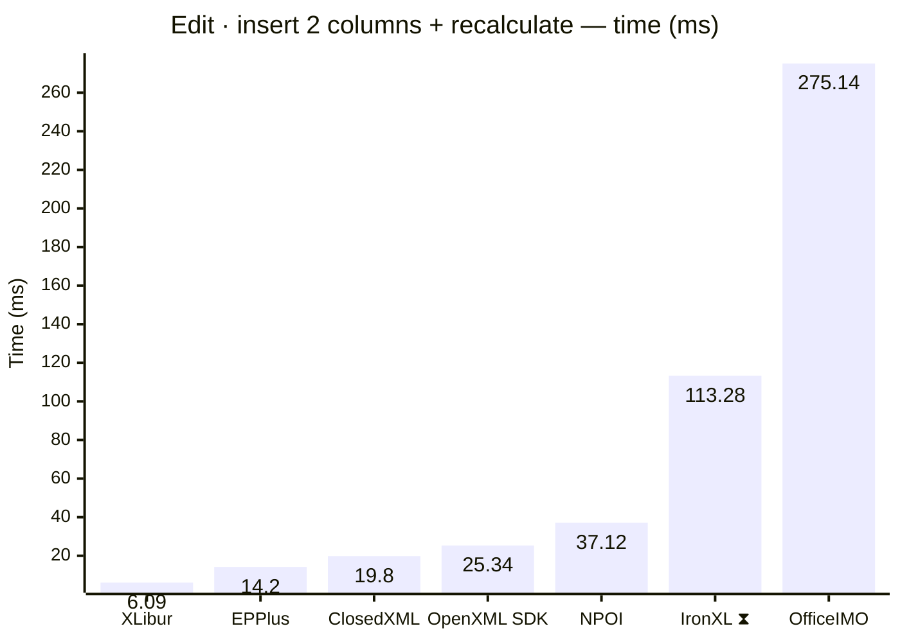

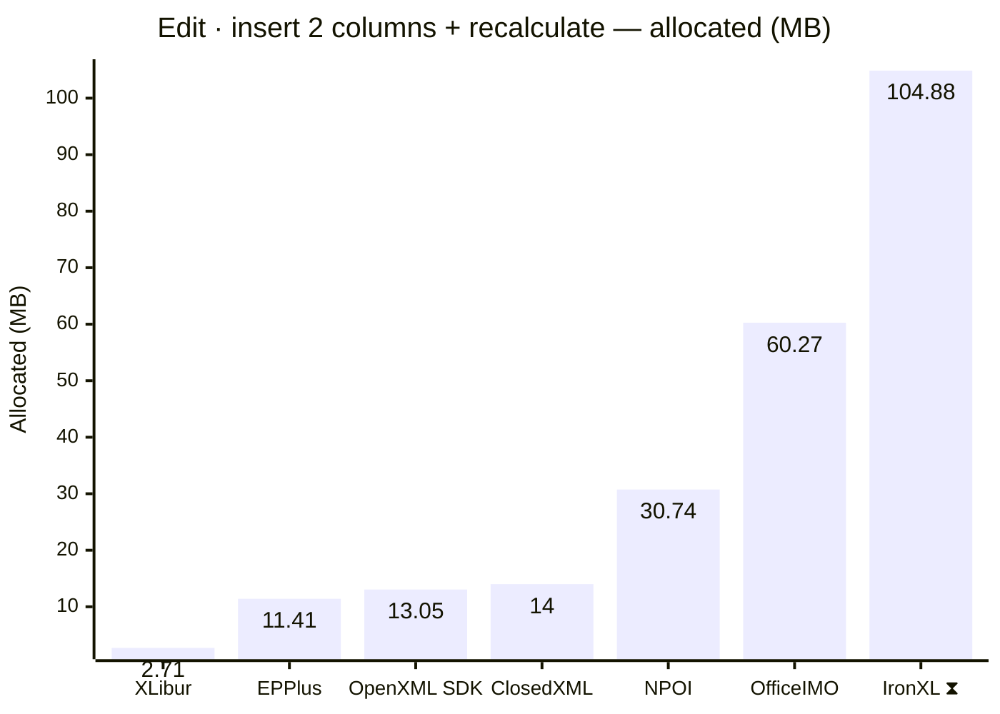

## Detailed results


```

BenchmarkDotNet v0.15.8, Linux Ubuntu 24.04.5 LTS (Noble Numbat)
AMD EPYC 9V45 4.19GHz, 1 CPU, 4 logical and 2 physical cores
.NET SDK 10.0.402
  [Host]   : .NET 10.0.13 (10.0.13, 10.0.1326.50504), X64 RyuJIT x86-64-v4
  ShortRun : .NET 10.0.13 (10.0.13, 10.0.1326.50504), X64 RyuJIT x86-64-v4

Job=ShortRun  IterationCount=3  LaunchCount=1  
WarmupCount=3  

```

### Read · open + set properties + save

| Library     | Type                      | Method                      | Mean          | Error         | StdDev      | Median        | Gen0       | Gen1       | Gen2      | Allocated  |
|------------ |-------------------------- |---------------------------- |--------------:|--------------:|------------:|--------------:|-----------:|-----------:|----------:|-----------:|
| OpenXML SDK | OpenXmlReadBenchmarks     | OpenAmendPropertiesAndSave  |     0.2377 ms |     0.8990 ms |   0.0493 ms |     0.2412 ms |    29.7852 |    20.5078 |   16.1133 |    0.34 MB |
| XLibur      | XLiburReadBenchmarks      | OpenAmendPropertiesAndSave  |     4.5842 ms |     4.1984 ms |   0.2301 ms |     4.4976 ms |    62.5000 |    31.2500 |         - |    1.35 MB |
| NPOI        | NpoiReadBenchmarks        | OpenAmendPropertiesAndSave  |    10.7745 ms |    64.3175 ms |   3.5255 ms |     8.9444 ms |    62.5000 |          - |         - |    1.89 MB |
| OfficeIMO   | OfficeImoReadBenchmarks   | OpenAmendPropertiesAndSave  |    19.1201 ms |     2.5746 ms |   0.1411 ms |    19.0602 ms |   562.5000 |   437.5000 |  406.2500 |    6.57 MB |
| EPPlus      | EpPlusReadBenchmarks      | OpenAmendPropertiesAndSave  |    23.4602 ms |    68.5263 ms |   3.7562 ms |    23.6353 ms |  1000.0000 |  1000.0000 | 1000.0000 |   13.82 MB |
| ClosedXML   | ClosedXmlReadBenchmarks   | OpenAmendPropertiesAndSave  |    29.7411 ms |    47.0645 ms |   2.5798 ms |    28.5701 ms |   714.2857 |   285.7143 |         - |   13.17 MB |
| IronXL ⧗ | IronXlReadBenchmarks | OpenAmendPropertiesAndSave | 208.746 ms | 155.7570 ms | 92.6885 ms | 168.705 ms | 9000.0000 | 2000.0000 | - | 152.81 MB |

### Read · open + read all cells

| Library     | Type                      | Method                      | Mean          | Error         | StdDev      | Median        | Gen0       | Gen1       | Gen2      | Allocated  |
|------------ |-------------------------- |---------------------------- |--------------:|--------------:|------------:|--------------:|-----------:|-----------:|----------:|-----------:|
| Sylvan      | SylvanReadBenchmarks      | OpenAndReadAll              |   256.3970 ms |    84.4330 ms |   4.6281 ms |   255.5563 ms |  1666.6667 |  1000.0000 |  333.3333 |   25.28 MB |
| MiniExcel   | MiniExcelReadBenchmarks   | OpenAndReadAll              |   549.0864 ms |   454.6192 ms |  24.9192 ms |   535.2195 ms | 50000.0000 |  3000.0000 |         - |  805.89 MB |
| XLibur      | XLiburReadBenchmarks      | OpenAndReadAll              |   786.2225 ms |   675.0462 ms |  37.0016 ms |   805.1265 ms |  8000.0000 |  5000.0000 | 1000.0000 |  135.96 MB |
| EPPlus      | EpPlusReadBenchmarks      | OpenAndReadAll              |   942.6336 ms |   240.3955 ms |  13.1769 ms |   935.3733 ms | 49000.0000 | 14000.0000 | 7000.0000 |  924.42 MB |
| OpenXML SDK | OpenXmlReadBenchmarks     | OpenAndReadAll              |   967.4870 ms |   146.9762 ms |   8.0563 ms |   965.1746 ms | 40000.0000 |  6000.0000 | 1000.0000 |  627.82 MB |
| NPOI        | NpoiReadBenchmarks        | OpenAndReadAll              | 2,522.8236 ms | 4,445.6324 ms | 243.6801 ms | 2,583.4591 ms | 67000.0000 | 62000.0000 | 6000.0000 | 1075.67 MB |
| OfficeIMO   | OfficeImoReadBenchmarks   | OpenAndReadAll              | 2,755.9183 ms | 1,262.3578 ms |  69.1941 ms | 2,791.0529 ms | 52000.0000 | 39000.0000 | 5000.0000 |  821.99 MB |
| ClosedXML   | ClosedXmlReadBenchmarks   | OpenAndReadAll              | 6,310.9285 ms | 1,411.1625 ms |  77.3506 ms | 6,302.1090 ms | 60000.0000 | 24000.0000 | 4000.0000 | 1073.33 MB |
| IronXL ⧗ | IronXlReadBenchmarks | OpenAndReadAll | 9,318.107 ms | 477.3336 ms | 315.7266 ms | 9,377.407 ms | 393000.0000 | 202000.0000 | 10000.0000 | 6333.04 MB |

### Write · create + save

| Library     | Type                      | Method                      | Mean          | Error         | StdDev      | Median        | Gen0       | Gen1       | Gen2      | Allocated  |
|------------ |-------------------------- |---------------------------- |--------------:|--------------:|------------:|--------------:|-----------:|-----------:|----------:|-----------:|
| Sylvan      | SylvanWriteBenchmarks     | CreateAndSave               |    32.1065 ms |    10.4601 ms |   0.5734 ms |    32.4339 ms |  1500.0000 |  1375.0000 | 1250.0000 |   13.27 MB |
| MiniExcel   | MiniExcelWriteBenchmarks  | CreateAndSave               |    50.9191 ms |    15.7390 ms |   0.8627 ms |    50.5081 ms |  5300.0000 |  1400.0000 | 1200.0000 |   84.59 MB |
| OpenXML SDK | OpenXmlWriteBenchmarks    | CreateAndSave               |   130.6063 ms |    28.5931 ms |   1.5673 ms |   130.7814 ms |  8750.0000 |  2000.0000 | 2000.0000 |  134.19 MB |
| XLibur      | XLiburWriteBenchmarks     | CreateAndSave               |   177.7439 ms |   451.6781 ms |  24.7580 ms |   170.6115 ms |  4000.0000 |  3000.0000 | 3000.0000 |   60.19 MB |
| ClosedXML   | ClosedXmlWriteBenchmarks  | CreateAndSave               |   401.3064 ms |   245.5232 ms |  13.4580 ms |   394.9557 ms | 11000.0000 |  6000.0000 | 3000.0000 |  181.09 MB |
| EPPlus      | EpPlusWriteBenchmarks     | CreateAndSave               |   442.9517 ms |   122.4345 ms |   6.7110 ms |   441.7131 ms | 20000.0000 |  9000.0000 | 3000.0000 |  322.56 MB |
| NPOI        | NpoiWriteBenchmarks       | CreateAndSave               |   777.3645 ms | 1,300.9010 ms |  71.3068 ms |   781.8308 ms | 16000.0000 | 12000.0000 | 3000.0000 |  246.27 MB |
| OfficeIMO   | OfficeImoWriteBenchmarks  | CreateAndSave               |   886.0472 ms |   284.0301 ms |  15.5686 ms |   887.4662 ms | 20000.0000 | 14000.0000 | 3000.0000 |  371.05 MB |
| IronXL ⧗ | IronXlWriteBenchmarks | CreateAndSave | 943.137 ms | 18.5191 ms | 11.0204 ms | 938.999 ms | 48000.0000 | 16000.0000 | 3000.0000 | 797.63 MB |

### Report · data + conditional formatting + chart

| Library     | Type                      | Method                      | Mean          | Error         | StdDev      | Median        | Gen0       | Gen1       | Gen2      | Allocated  |
|------------ |-------------------------- |---------------------------- |--------------:|--------------:|------------:|--------------:|-----------:|-----------:|----------:|-----------:|
| OpenXML SDK | OpenXmlReportBenchmarks   | CreateStockReport           |     8.0539 ms |     1.0897 ms |   0.0597 ms |     8.0811 ms |   375.0000 |   359.3750 |  187.5000 |    4.92 MB |
| XLibur      | XLiburReportBenchmarks    | CreateStockReport           |     8.9852 ms |     6.6064 ms |   0.3621 ms |     8.8296 ms |   187.5000 |   187.5000 |  187.5000 |    3.35 MB |
| ClosedXML   | ClosedXmlReportBenchmarks | CreateStockReport           |    17.3569 ms |    17.7500 ms |   0.9729 ms |    16.9167 ms |   468.7500 |   343.7500 |  187.5000 |    8.01 MB |
| EPPlus      | EpPlusReportBenchmarks    | CreateStockReport           |    26.2573 ms |    52.8329 ms |   2.8959 ms |    26.9795 ms |  1000.0000 |  1000.0000 | 1000.0000 |   13.94 MB |
| NPOI        | NpoiReportBenchmarks      | CreateStockReport           |    53.8983 ms |   278.7696 ms |  15.2803 ms |    53.0925 ms |   833.3333 |   666.6667 |  333.3333 |   16.28 MB |
| OfficeIMO   | OfficeImoReportBenchmarks | CreateStockReport           |   205.5219 ms |    79.1750 ms |   4.3399 ms |   203.3680 ms | 57000.0000 |  2000.0000 |  666.6667 |  905.66 MB |
| IronXL ⧗ | IronXlReportBenchmarks | CreateStockReport | 387.849 ms | 36.5456 ms | 24.1726 ms | 384.092 ms | 14000.0000 | 3000.0000 | - | 237.38 MB |

### Edit · delete rows + set column + recalculate

| Library     | Type                      | Method                      | Mean          | Error         | StdDev      | Median        | Gen0       | Gen1       | Gen2      | Allocated  |
|------------ |-------------------------- |---------------------------- |--------------:|--------------:|------------:|--------------:|-----------:|-----------:|----------:|-----------:|
| XLibur      | XLiburEditBenchmarks      | EditAndRecalculate          |     5.4693 ms |     0.4067 ms |   0.0223 ms |     5.4652 ms |   164.0625 |    78.1250 |         - |    2.68 MB |
| OpenXML SDK | OpenXmlEditBenchmarks     | EditAndRecalculate          |    25.4535 ms |   200.5969 ms |  10.9954 ms |    19.4419 ms |   500.0000 |   333.3333 |         - |     9.8 MB |
| EPPlus      | EpPlusEditBenchmarks      | EditAndRecalculate          |    78.5614 ms |   106.0015 ms |   5.8103 ms |    75.8739 ms |  9000.0000 |  1166.6667 | 1000.0000 |  142.49 MB |
| NPOI        | NpoiEditBenchmarks        | EditAndRecalculate          |   319.5565 ms |   238.3836 ms |  13.0666 ms |   313.3599 ms | 25000.0000 |  1000.0000 |         - |  413.38 MB |
| ClosedXML   | ClosedXmlEditBenchmarks   | EditAndRecalculate          |   377.8900 ms |   286.5502 ms |  15.7068 ms |   380.2356 ms | 21000.0000 |   500.0000 |         - |  337.66 MB |
| IronXL ⧗ | IronXlEditBenchmarks | EditAndRecalculate | 1,577.273 ms | 62.9583 ms | 41.6430 ms | 1,583.098 ms | 57000.0000 | 36000.0000 | 15000.0000 | 753.86 MB |
| OfficeIMO   | OfficeImoEditBenchmarks   | EditAndRecalculate          | 1,979.1065 ms |   723.5000 ms |  39.6575 ms | 1,961.5597 ms | 30000.0000 |  1000.0000 |         - |  493.93 MB |

### Edit · insert 2 columns + recalculate

| Library     | Type                      | Method                      | Mean          | Error         | StdDev      | Median        | Gen0       | Gen1       | Gen2      | Allocated  |
|------------ |-------------------------- |---------------------------- |--------------:|--------------:|------------:|--------------:|-----------:|-----------:|----------:|-----------:|
| XLibur      | XLiburInsertBenchmarks    | InsertColumnsAndRecalculate |     6.0930 ms |     1.5838 ms |   0.0868 ms |     6.0490 ms |   156.2500 |    62.5000 |         - |    2.71 MB |
| EPPlus      | EpPlusInsertBenchmarks    | InsertColumnsAndRecalculate |    14.1991 ms |     7.7440 ms |   0.4245 ms |    14.0598 ms |  1000.0000 |  1000.0000 | 1000.0000 |   11.41 MB |
| ClosedXML   | ClosedXmlInsertBenchmarks | InsertColumnsAndRecalculate |    19.7971 ms |     6.8492 ms |   0.3754 ms |    19.7258 ms |   875.0000 |   531.2500 |         - |      14 MB |
| OpenXML SDK | OpenXmlInsertBenchmarks   | InsertColumnsAndRecalculate |    25.3389 ms |     9.3390 ms |   0.5119 ms |    25.6335 ms |  1125.0000 |  1062.5000 |  437.5000 |   13.05 MB |
| NPOI        | NpoiInsertBenchmarks      | InsertColumnsAndRecalculate |    37.1154 ms |   115.0651 ms |   6.3071 ms |    34.9519 ms |  2000.0000 |  1333.3333 |  500.0000 |   30.74 MB |
| IronXL ⧗ | IronXlInsertBenchmarks | InsertColumnsAndRecalculate | 113.284 ms | 41.9750 ms | 27.7638 ms | 97.052 ms | 7000.0000 | 2500.0000 | 750.0000 | 104.88 MB |
| OfficeIMO   | OfficeImoInsertBenchmarks | InsertColumnsAndRecalculate |   275.1416 ms | 1,257.9372 ms |  68.9518 ms |   269.2702 ms |  3000.0000 |  1000.0000 |         - |   60.27 MB |


<script type="module">
  import mermaid from 'https://cdn.jsdelivr.net/npm/mermaid@11/dist/mermaid.esm.min.mjs';
  const blocks = document.querySelectorAll('.language-mermaid');
  blocks.forEach(el => {
    const code = el.querySelector('code') || el;
    const pre = document.createElement('pre');
    pre.className = 'mermaid';
    pre.textContent = code.textContent;
    el.replaceWith(pre);
  });
  if (blocks.length) {
    mermaid.initialize({ startOnLoad: false });
    await mermaid.run({ querySelector: 'pre.mermaid' });
  }
</script>

<script>
(function () {
  const parse = s => { const n = parseFloat(String(s).replace(/,/g, '')); return Number.isFinite(n) ? n : null; };
  document.querySelectorAll('table').forEach(table => {
    if (!table.tHead || !table.tBodies[0]) return;
    const heads = [...table.tHead.rows[0].cells].map(c => c.textContent.trim().toLowerCase());
    if (!heads.includes('mean')) return;
    const metricCols = heads.map((h, i) => /^(mean|allocated|gen0|gen1|gen2)$/.test(h) ? i : -1).filter(i => i >= 0);
    const rows = [...table.tBodies[0].rows];
    for (const c of metricCols) {
      const vals = rows.map(r => parse(r.cells[c]?.textContent));
      const nums = vals.filter(v => v !== null);
      if (nums.length < 2) continue;
      const min = Math.min(...nums), max = Math.max(...nums);
      if (max === min) continue;
      rows.forEach((r, i) => {
        const v = vals[i]; if (v === null) return;
        const ratio = (v - min) / (max - min);
        r.cells[c].style.backgroundColor = `hsla(${120 - 120 * ratio}, 70%, 50%, 0.45)`;
      });
    }
  });
})();
</script>
