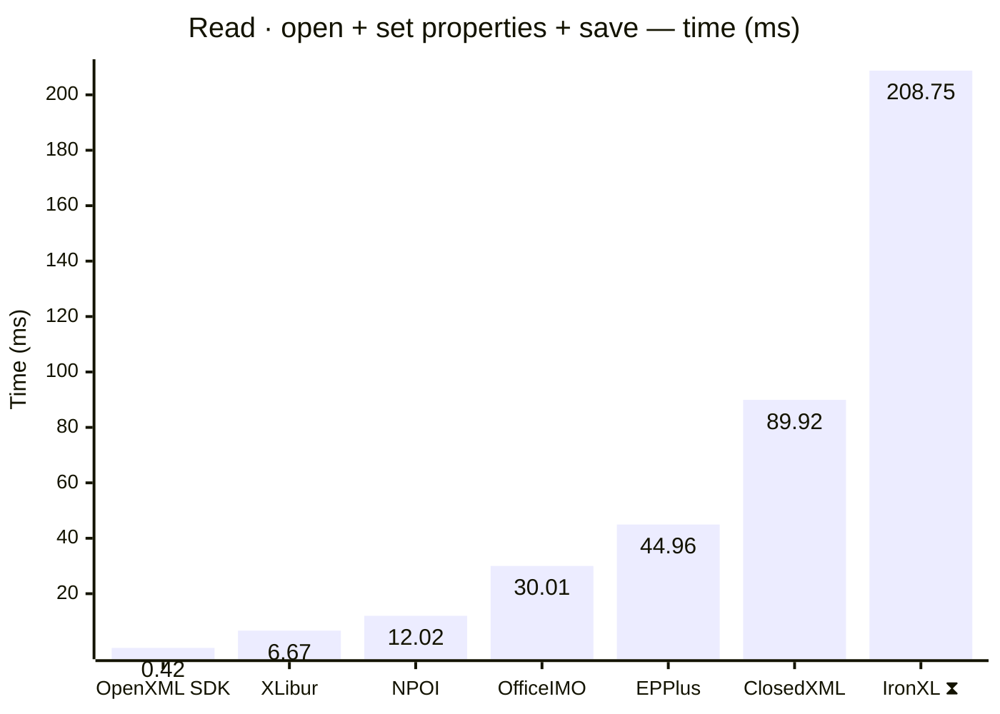
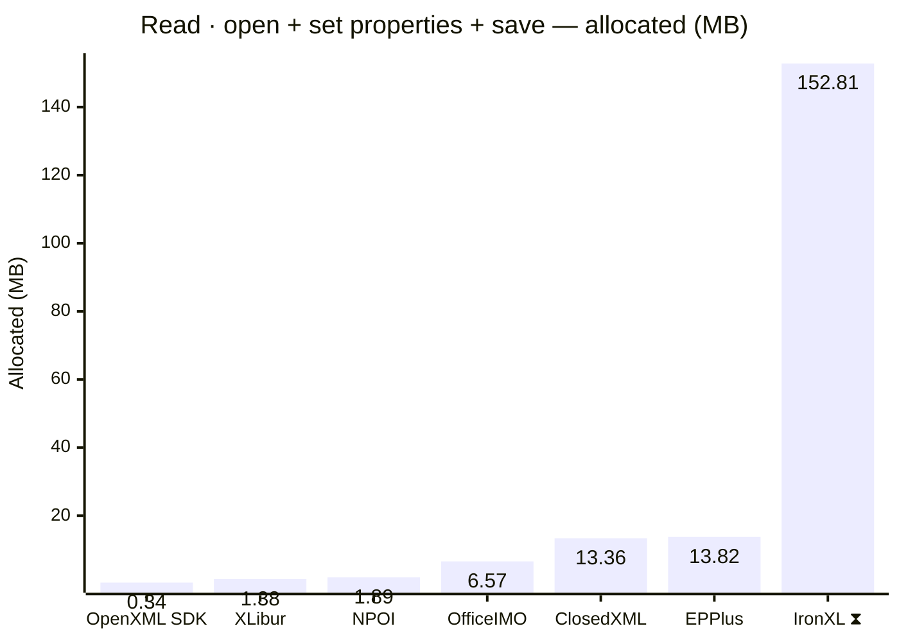
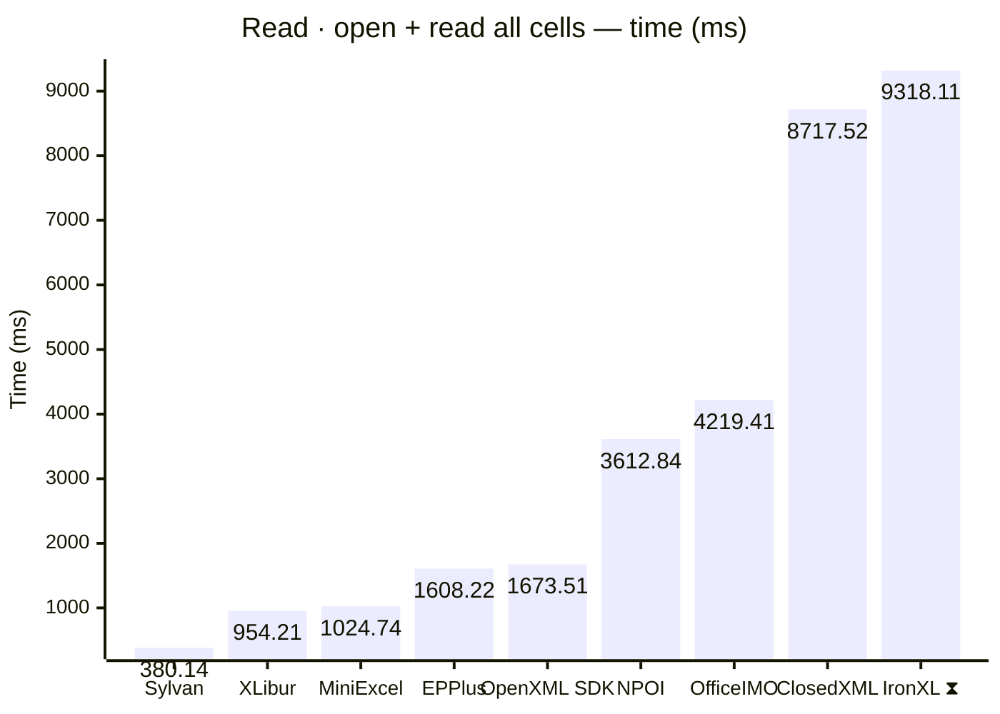
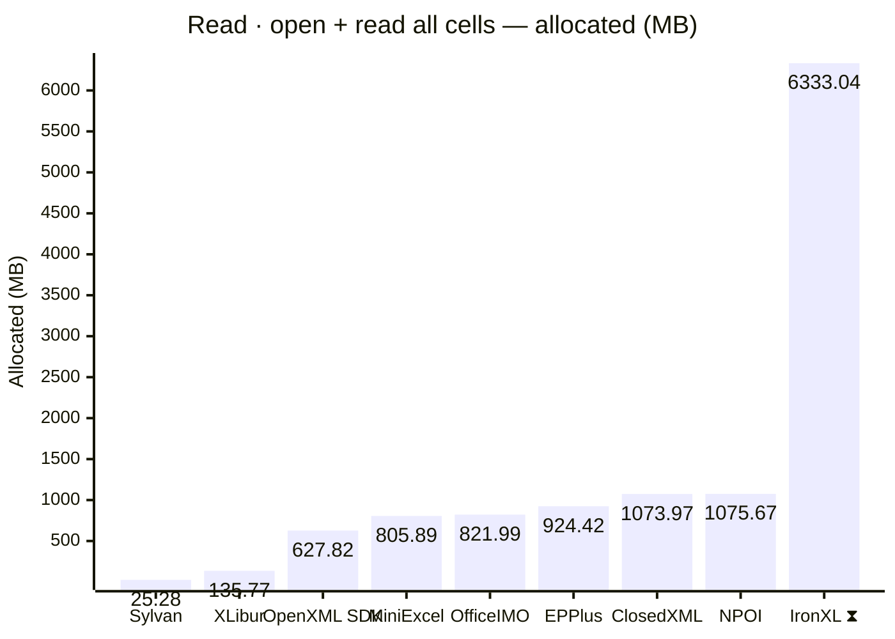
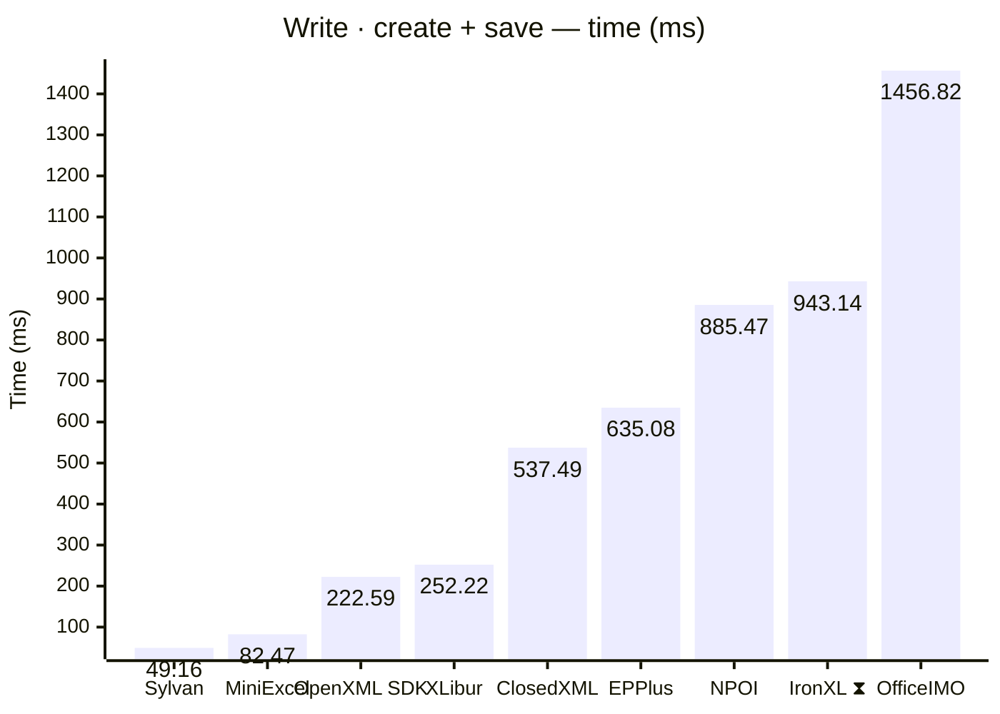
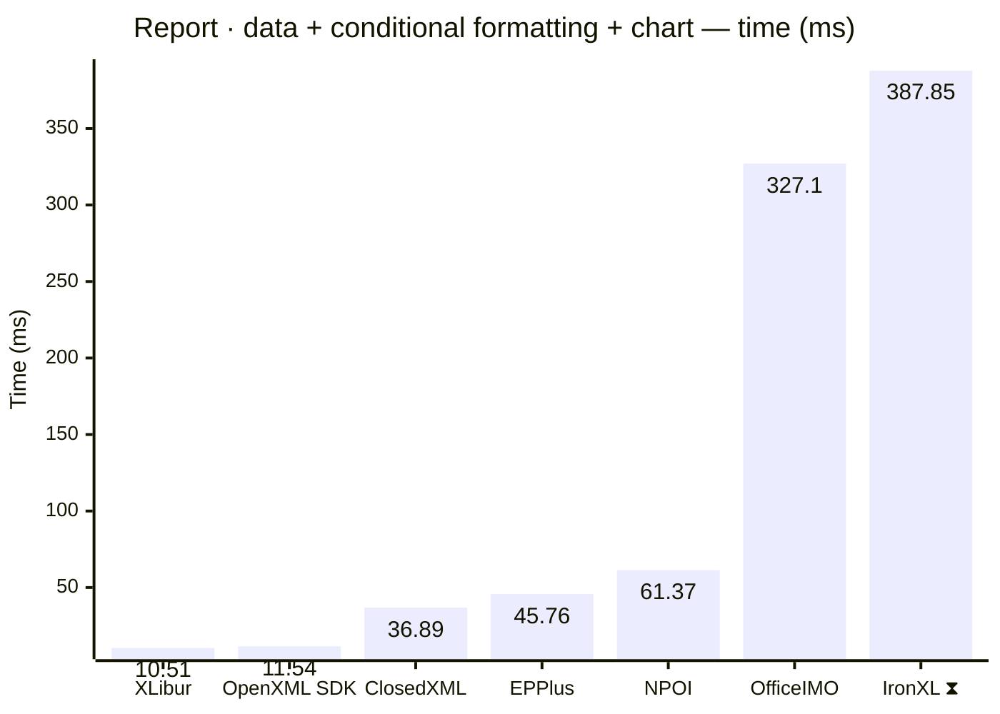
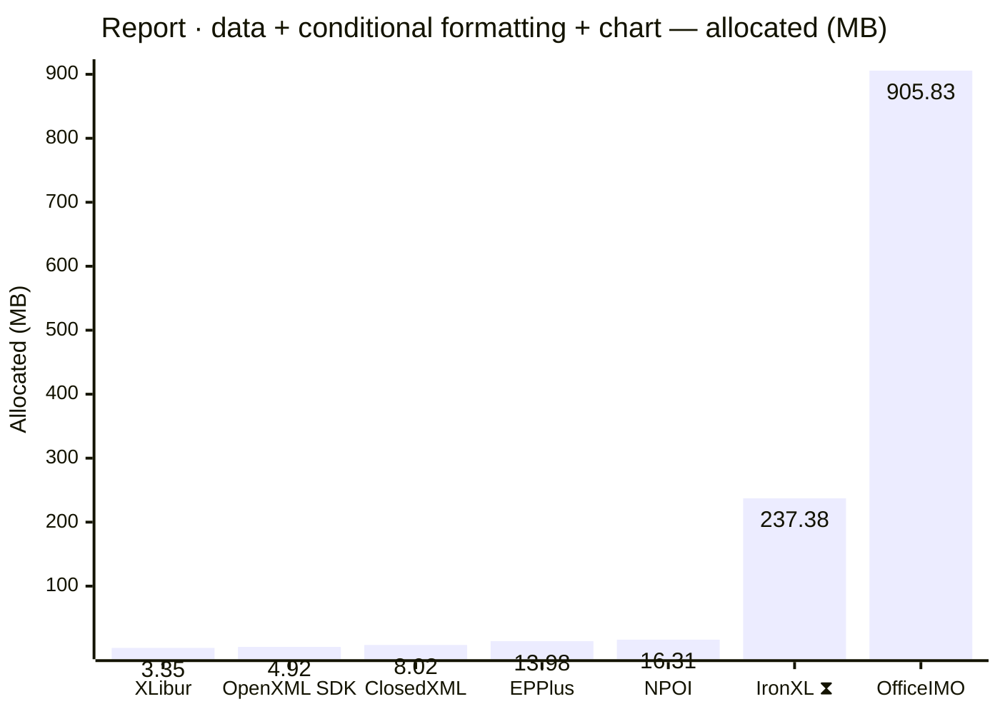
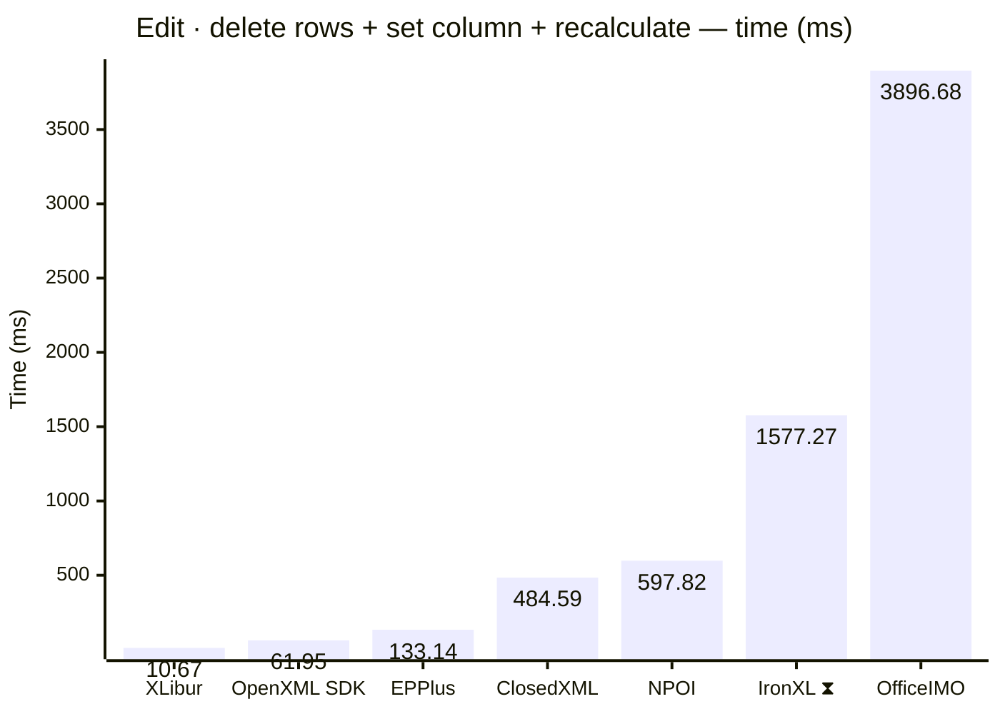
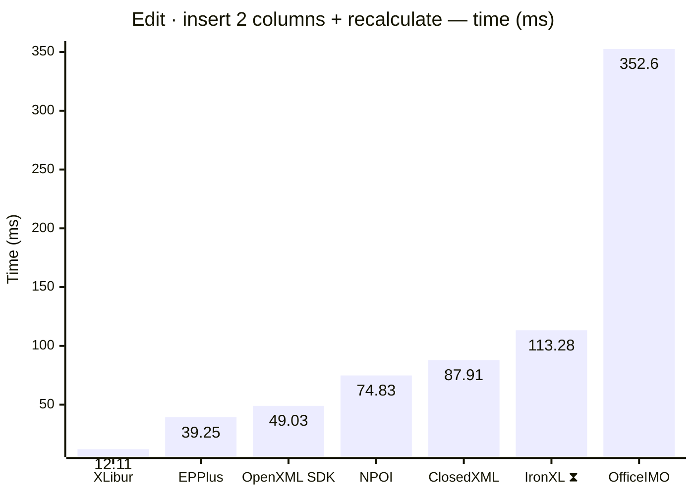
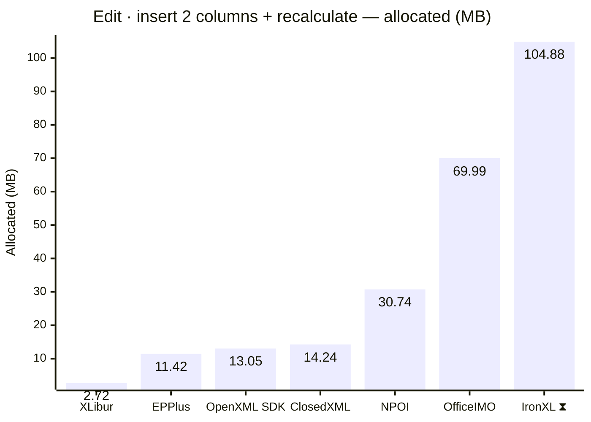

<style>
  .main-content { max-width: 90% !important; padding-left: 2rem !important; padding-right: 2rem !important; }
</style>
<!-- Generated by XLBench. Do not edit by hand; re-run scripts/run-benchmarks.ps1. -->
# XLBench Results

Each section below embeds the full BenchmarkDotNet environment block (OS, CPU,
.NET SDK and runtime). Timings are hardware-specific; treat the allocation/GC
columns as the most portable signal across machines. Regenerate locally with
`scripts/run-benchmarks.ps1`.

> ⚠️ Generated on a shared GitHub Actions runner — timings are indicative and vary run to run; allocation/memory figures are reliable. Authoritative timings come from a local run: [results.html](results.html).

📈 **[Interactive charts](charts.html)** (GitHub Pages). Static charts and the full tables follow.

Each results table (one per test method) is heat-mapped independently on the Pages site (🟩 best → 🟥 worst).

> ⧗ **Carried over from an earlier run.** The rows and chart points below marked with this symbol were not measured here — the library is commercial and needs a licence key this run did not have — so they are replayed from `snapshots/`. Compare them as indicative rather than like-for-like, and see the repository README for how to refresh a snapshot.
>
> - **IronXL** 2026.8.1, Job-HTCPYF job, captured 2026-08-03 on different hardware — Windows 11 (10.0.22631.6199/23H2/2023Update/SunValley3), AMD Ryzen 9 5950X 16-Core Processor.

## Libraries under test

| Library | Version | Source |
| --- | --- | --- |
| ClosedXML | 0.105.1 | this run |
| EPPlus | 8.7.2 | this run |
| OpenXML SDK | 3.5.1 | this run |
| NPOI | 2.8.1 | this run |
| MiniExcel | 1.46.0 | this run |
| Sylvan | 0.5.8 | this run |
| XLibur | 0.720.0 | this run |
| OfficeIMO | 3.5.1 | this run |
| IronXL ⧗ | 2026.8.1 | snapshot (2026.8.1, Job-HTCPYF, captured 2026-08-03) |

## Comparison charts

_Lower is better. Charts render in the GitHub file view; the Pages site has interactive versions._























## Detailed results


```

BenchmarkDotNet v0.15.8, Linux Ubuntu 24.04.5 LTS (Noble Numbat)
AMD EPYC 7763 2.74GHz, 1 CPU, 4 logical and 2 physical cores
.NET SDK 10.0.403
  [Host]   : .NET 10.0.14 (10.0.14, 10.0.1426.52326), X64 RyuJIT x86-64-v3
  ShortRun : .NET 10.0.14 (10.0.14, 10.0.1426.52326), X64 RyuJIT x86-64-v3

Job=ShortRun  IterationCount=3  LaunchCount=1  
WarmupCount=3  

```

### Read · open + set properties + save

| Library     | Type                      | Method                      | Mean          | Error         | StdDev      | Median        | Gen0       | Gen1       | Gen2      | Allocated  |
|------------ |-------------------------- |---------------------------- |--------------:|--------------:|------------:|--------------:|-----------:|-----------:|----------:|-----------:|
| OpenXML SDK | OpenXmlReadBenchmarks     | OpenAmendPropertiesAndSave  |     0.4151 ms |     0.8997 ms |   0.0493 ms |     0.4088 ms |    28.3203 |    17.5781 |   14.6484 |    0.34 MB |
| XLibur      | XLiburReadBenchmarks      | OpenAmendPropertiesAndSave  |     6.6682 ms |     0.4608 ms |   0.0253 ms |     6.6565 ms |    78.1250 |    31.2500 |         - |    1.38 MB |
| NPOI        | NpoiReadBenchmarks        | OpenAmendPropertiesAndSave  |    12.0248 ms |     1.8478 ms |   0.1013 ms |    11.9797 ms |   125.0000 |    93.7500 |   62.5000 |    1.89 MB |
| OfficeIMO   | OfficeImoReadBenchmarks   | OpenAmendPropertiesAndSave  |    30.0112 ms |     5.4028 ms |   0.2961 ms |    30.0902 ms |   437.5000 |   312.5000 |  312.5000 |    6.57 MB |
| EPPlus      | EpPlusReadBenchmarks      | OpenAmendPropertiesAndSave  |    44.9634 ms |   120.3086 ms |   6.5945 ms |    44.5435 ms |  1000.0000 |  1000.0000 | 1000.0000 |   13.82 MB |
| ClosedXML   | ClosedXmlReadBenchmarks   | OpenAmendPropertiesAndSave  |    89.9232 ms |   962.5374 ms |  52.7599 ms |    70.1112 ms |   750.0000 |   250.0000 |         - |   13.36 MB |
| IronXL ⧗ | IronXlReadBenchmarks | OpenAmendPropertiesAndSave | 208.746 ms | 155.7570 ms | 92.6885 ms | 168.705 ms | 9000.0000 | 2000.0000 | - | 152.81 MB |

### Read · open + read all cells

| Library     | Type                      | Method                      | Mean          | Error         | StdDev      | Median        | Gen0       | Gen1       | Gen2      | Allocated  |
|------------ |-------------------------- |---------------------------- |--------------:|--------------:|------------:|--------------:|-----------:|-----------:|----------:|-----------:|
| Sylvan      | SylvanReadBenchmarks      | OpenAndReadAll              |   380.1373 ms |    40.2383 ms |   2.2056 ms |   379.7505 ms |  1000.0000 |          - |         - |   25.28 MB |
| XLibur      | XLiburReadBenchmarks      | OpenAndReadAll              |   954.2062 ms |    60.1437 ms |   3.2967 ms |   952.7367 ms |  8000.0000 |  5000.0000 | 1000.0000 |  135.77 MB |
| MiniExcel   | MiniExcelReadBenchmarks   | OpenAndReadAll              | 1,024.7372 ms |   172.4064 ms |   9.4502 ms | 1,029.7715 ms | 50000.0000 |  3000.0000 |         - |  805.89 MB |
| EPPlus      | EpPlusReadBenchmarks      | OpenAndReadAll              | 1,608.2240 ms |   102.0717 ms |   5.5949 ms | 1,606.8028 ms | 49000.0000 | 14000.0000 | 7000.0000 |  924.42 MB |
| OpenXML SDK | OpenXmlReadBenchmarks     | OpenAndReadAll              | 1,673.5135 ms |    42.9683 ms |   2.3552 ms | 1,672.6883 ms | 40000.0000 |  5000.0000 | 1000.0000 |  627.82 MB |
| NPOI        | NpoiReadBenchmarks        | OpenAndReadAll              | 3,612.8408 ms | 5,251.2494 ms | 287.8387 ms | 3,774.0435 ms | 67000.0000 | 62000.0000 | 6000.0000 | 1075.67 MB |
| OfficeIMO   | OfficeImoReadBenchmarks   | OpenAndReadAll              | 4,219.4069 ms |   299.0574 ms |  16.3923 ms | 4,221.3126 ms | 52000.0000 | 39000.0000 | 5000.0000 |  821.99 MB |
| ClosedXML   | ClosedXmlReadBenchmarks   | OpenAndReadAll              | 8,717.5154 ms |   296.3018 ms |  16.2413 ms | 8,712.8182 ms | 60000.0000 | 24000.0000 | 4000.0000 | 1073.97 MB |
| IronXL ⧗ | IronXlReadBenchmarks | OpenAndReadAll | 9,318.107 ms | 477.3336 ms | 315.7266 ms | 9,377.407 ms | 393000.0000 | 202000.0000 | 10000.0000 | 6333.04 MB |

### Write · create + save

| Library     | Type                      | Method                      | Mean          | Error         | StdDev      | Median        | Gen0       | Gen1       | Gen2      | Allocated  |
|------------ |-------------------------- |---------------------------- |--------------:|--------------:|------------:|--------------:|-----------:|-----------:|----------:|-----------:|
| Sylvan      | SylvanWriteBenchmarks     | CreateAndSave               |    49.1608 ms |     2.8764 ms |   0.1577 ms |    49.2140 ms |  1818.1818 |  1727.2727 | 1545.4545 |   13.27 MB |
| MiniExcel   | MiniExcelWriteBenchmarks  | CreateAndSave               |    82.4689 ms |     5.6386 ms |   0.3091 ms |    82.5772 ms |  5500.0000 |  1500.0000 | 1500.0000 |   84.59 MB |
| OpenXML SDK | OpenXmlWriteBenchmarks    | CreateAndSave               |   222.5882 ms |     8.5225 ms |   0.4671 ms |   222.8064 ms |  9000.0000 |  2333.3333 | 2333.3333 |  134.19 MB |
| XLibur      | XLiburWriteBenchmarks     | CreateAndSave               |   252.2184 ms |   246.8508 ms |  13.5307 ms |   257.9562 ms |  3000.0000 |  2000.0000 | 2000.0000 |   60.19 MB |
| ClosedXML   | ClosedXmlWriteBenchmarks  | CreateAndSave               |   537.4949 ms |    43.1461 ms |   2.3650 ms |   537.5654 ms | 10000.0000 |  5000.0000 | 2000.0000 |  181.09 MB |
| EPPlus      | EpPlusWriteBenchmarks     | CreateAndSave               |   635.0835 ms |   172.2349 ms |   9.4408 ms |   632.0147 ms | 20000.0000 |  9000.0000 | 3000.0000 |  322.56 MB |
| NPOI        | NpoiWriteBenchmarks       | CreateAndSave               |   885.4693 ms |   120.8378 ms |   6.6235 ms |   888.5384 ms | 16000.0000 | 12000.0000 | 3000.0000 |  246.27 MB |
| IronXL ⧗ | IronXlWriteBenchmarks | CreateAndSave | 943.137 ms | 18.5191 ms | 11.0204 ms | 938.999 ms | 48000.0000 | 16000.0000 | 3000.0000 | 797.63 MB |
| OfficeIMO   | OfficeImoWriteBenchmarks  | CreateAndSave               | 1,456.8229 ms |   324.4603 ms |  17.7848 ms | 1,461.0418 ms | 22000.0000 | 16000.0000 | 3000.0000 |  406.68 MB |

### Report · data + conditional formatting + chart

| Library     | Type                      | Method                      | Mean          | Error         | StdDev      | Median        | Gen0       | Gen1       | Gen2      | Allocated  |
|------------ |-------------------------- |---------------------------- |--------------:|--------------:|------------:|--------------:|-----------:|-----------:|----------:|-----------:|
| XLibur      | XLiburReportBenchmarks    | CreateStockReport           |    10.5058 ms |     1.5797 ms |   0.0866 ms |    10.4680 ms |   187.5000 |   187.5000 |  187.5000 |    3.35 MB |
| OpenXML SDK | OpenXmlReportBenchmarks   | CreateStockReport           |    11.5355 ms |     0.9096 ms |   0.0499 ms |    11.5382 ms |   375.0000 |   359.3750 |  187.5000 |    4.92 MB |
| ClosedXML   | ClosedXmlReportBenchmarks | CreateStockReport           |    36.8921 ms |    99.9065 ms |   5.4762 ms |    38.8126 ms |   400.0000 |          - |         - |    8.02 MB |
| EPPlus      | EpPlusReportBenchmarks    | CreateStockReport           |    45.7646 ms |    92.0796 ms |   5.0472 ms |    45.8567 ms |  1000.0000 |  1000.0000 | 1000.0000 |   13.98 MB |
| NPOI        | NpoiReportBenchmarks      | CreateStockReport           |    61.3709 ms |   312.3079 ms |  17.1187 ms |    57.3164 ms |   833.3333 |   666.6667 |  333.3333 |   16.31 MB |
| OfficeIMO   | OfficeImoReportBenchmarks | CreateStockReport           |   327.1024 ms |    56.2113 ms |   3.0811 ms |   325.6212 ms | 56000.0000 |  2000.0000 |         - |  905.83 MB |
| IronXL ⧗ | IronXlReportBenchmarks | CreateStockReport | 387.849 ms | 36.5456 ms | 24.1726 ms | 384.092 ms | 14000.0000 | 3000.0000 | - | 237.38 MB |

### Edit · delete rows + set column + recalculate

| Library     | Type                      | Method                      | Mean          | Error         | StdDev      | Median        | Gen0       | Gen1       | Gen2      | Allocated  |
|------------ |-------------------------- |---------------------------- |--------------:|--------------:|------------:|--------------:|-----------:|-----------:|----------:|-----------:|
| XLibur      | XLiburEditBenchmarks      | EditAndRecalculate          |    10.6737 ms |     1.8574 ms |   0.1018 ms |    10.6158 ms |   156.2500 |    78.1250 |         - |    2.68 MB |
| OpenXML SDK | OpenXmlEditBenchmarks     | EditAndRecalculate          |    61.9488 ms |   461.2341 ms |  25.2818 ms |    47.5197 ms |   333.3333 |          - |         - |    8.57 MB |
| EPPlus      | EpPlusEditBenchmarks      | EditAndRecalculate          |   133.1377 ms |    37.5646 ms |   2.0590 ms |   132.1557 ms |  9000.0000 |  1333.3333 | 1000.0000 |   142.5 MB |
| ClosedXML   | ClosedXmlEditBenchmarks   | EditAndRecalculate          |   484.5917 ms |    83.0506 ms |   4.5523 ms |   485.1497 ms | 21000.0000 |  1000.0000 |         - |  337.96 MB |
| NPOI        | NpoiEditBenchmarks        | EditAndRecalculate          |   597.8167 ms |   138.0363 ms |   7.5662 ms |   600.5467 ms | 25000.0000 |  1000.0000 |         - |  413.38 MB |
| IronXL ⧗ | IronXlEditBenchmarks | EditAndRecalculate | 1,577.273 ms | 62.9583 ms | 41.6430 ms | 1,583.098 ms | 57000.0000 | 36000.0000 | 15000.0000 | 753.86 MB |
| OfficeIMO   | OfficeImoEditBenchmarks   | EditAndRecalculate          | 3,896.6841 ms |   414.2177 ms |  22.7047 ms | 3,903.3181 ms | 30000.0000 |  1000.0000 |         - |  493.89 MB |

### Edit · insert 2 columns + recalculate

| Library     | Type                      | Method                      | Mean          | Error         | StdDev      | Median        | Gen0       | Gen1       | Gen2      | Allocated  |
|------------ |-------------------------- |---------------------------- |--------------:|--------------:|------------:|--------------:|-----------:|-----------:|----------:|-----------:|
| XLibur      | XLiburInsertBenchmarks    | InsertColumnsAndRecalculate |    12.1115 ms |     0.2362 ms |   0.0129 ms |    12.1125 ms |   156.2500 |    62.5000 |         - |    2.72 MB |
| EPPlus      | EpPlusInsertBenchmarks    | InsertColumnsAndRecalculate |    39.2476 ms |   199.5613 ms |  10.9386 ms |    38.3535 ms |  1000.0000 |  1000.0000 | 1000.0000 |   11.42 MB |
| OpenXML SDK | OpenXmlInsertBenchmarks   | InsertColumnsAndRecalculate |    49.0294 ms |    89.7013 ms |   4.9168 ms |    46.2512 ms |  1000.0000 |   666.6667 |  333.3333 |   13.05 MB |
| NPOI        | NpoiInsertBenchmarks      | InsertColumnsAndRecalculate |    74.8272 ms |   163.5674 ms |   8.9657 ms |    74.5360 ms |  2000.0000 |  1500.0000 |  500.0000 |   30.74 MB |
| ClosedXML   | ClosedXmlInsertBenchmarks | InsertColumnsAndRecalculate |    87.9114 ms |   269.4971 ms |  14.7720 ms |    82.8765 ms |   666.6667 |   333.3333 |         - |   14.24 MB |
| IronXL ⧗ | IronXlInsertBenchmarks | InsertColumnsAndRecalculate | 113.284 ms | 41.9750 ms | 27.7638 ms | 97.052 ms | 7000.0000 | 2500.0000 | 750.0000 | 104.88 MB |
| OfficeIMO   | OfficeImoInsertBenchmarks | InsertColumnsAndRecalculate |   352.5988 ms |   380.0274 ms |  20.8306 ms |   359.8085 ms |  5000.0000 |  2000.0000 | 1000.0000 |   69.99 MB |


<script type="module">
  import mermaid from 'https://cdn.jsdelivr.net/npm/mermaid@11/dist/mermaid.esm.min.mjs';
  const blocks = document.querySelectorAll('.language-mermaid');
  blocks.forEach(el => {
    const code = el.querySelector('code') || el;
    const pre = document.createElement('pre');
    pre.className = 'mermaid';
    pre.textContent = code.textContent;
    el.replaceWith(pre);
  });
  if (blocks.length) {
    mermaid.initialize({ startOnLoad: false });
    await mermaid.run({ querySelector: 'pre.mermaid' });
  }
</script>

<script>
(function () {
  const parse = s => { const n = parseFloat(String(s).replace(/,/g, '')); return Number.isFinite(n) ? n : null; };
  document.querySelectorAll('table').forEach(table => {
    if (!table.tHead || !table.tBodies[0]) return;
    const heads = [...table.tHead.rows[0].cells].map(c => c.textContent.trim().toLowerCase());
    if (!heads.includes('mean')) return;
    const metricCols = heads.map((h, i) => /^(mean|allocated|gen0|gen1|gen2)$/.test(h) ? i : -1).filter(i => i >= 0);
    const rows = [...table.tBodies[0].rows];
    for (const c of metricCols) {
      const vals = rows.map(r => parse(r.cells[c]?.textContent));
      const nums = vals.filter(v => v !== null);
      if (nums.length < 2) continue;
      const min = Math.min(...nums), max = Math.max(...nums);
      if (max === min) continue;
      rows.forEach((r, i) => {
        const v = vals[i]; if (v === null) return;
        const ratio = (v - min) / (max - min);
        r.cells[c].style.backgroundColor = `hsla(${120 - 120 * ratio}, 70%, 50%, 0.45)`;
      });
    }
  });
})();
</script>
