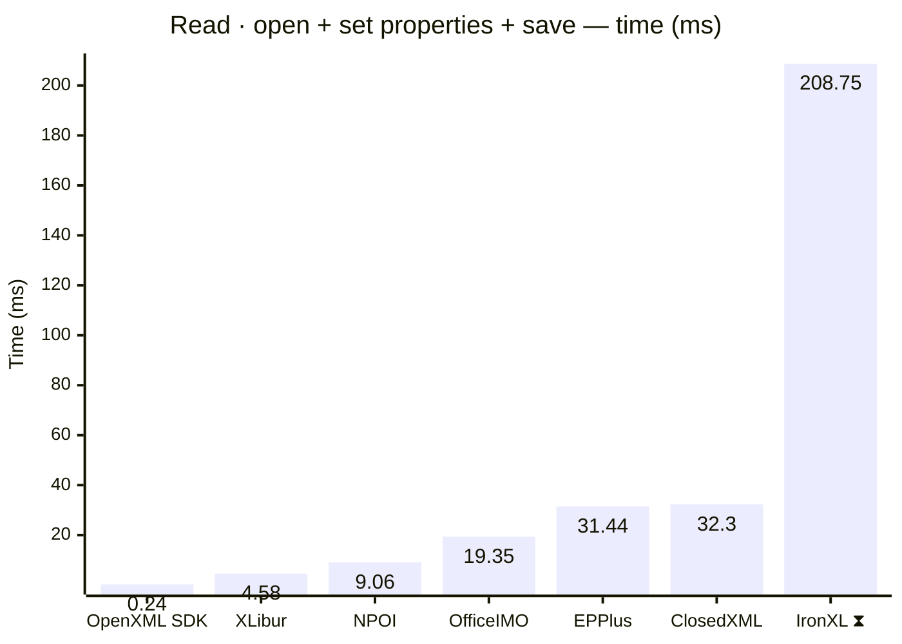
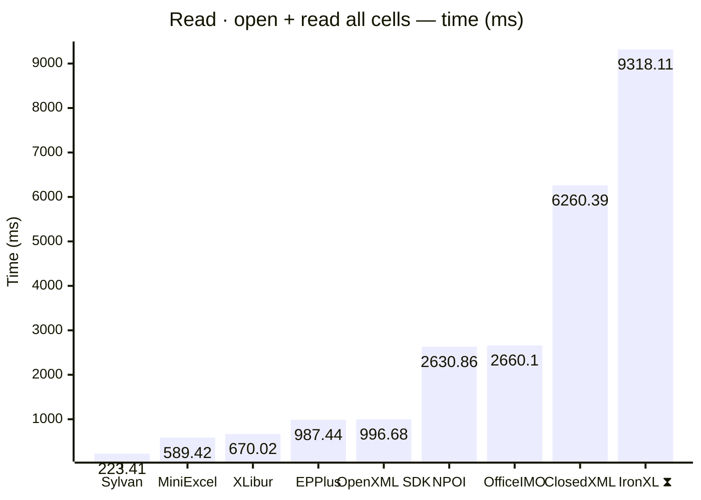
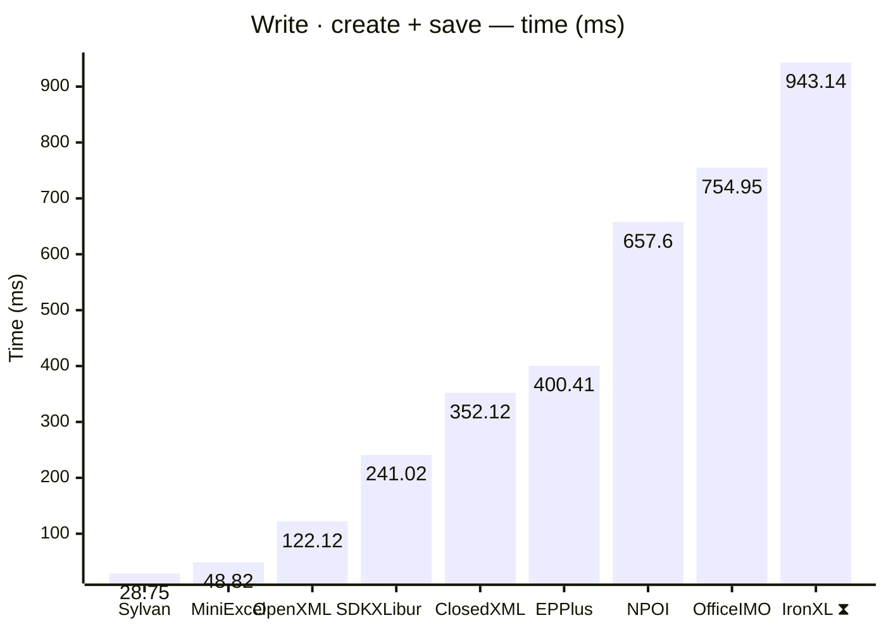
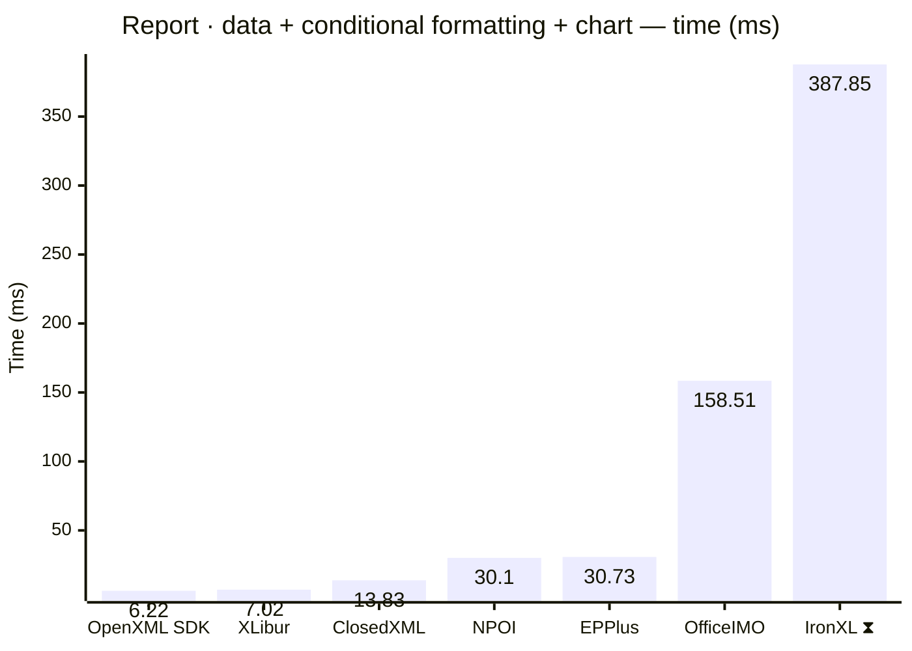
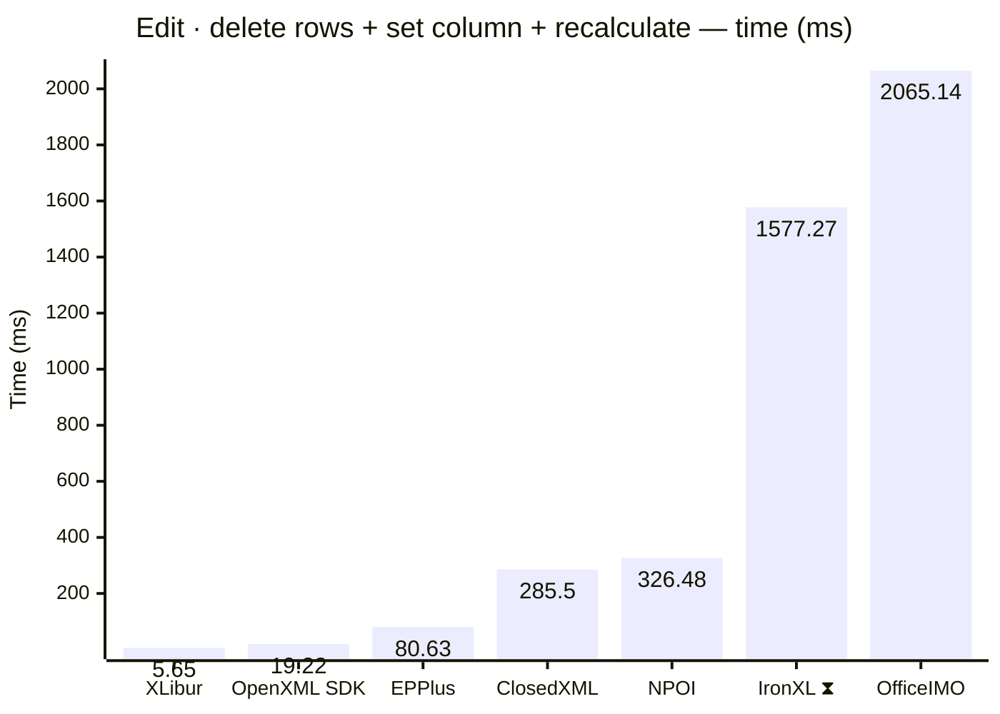
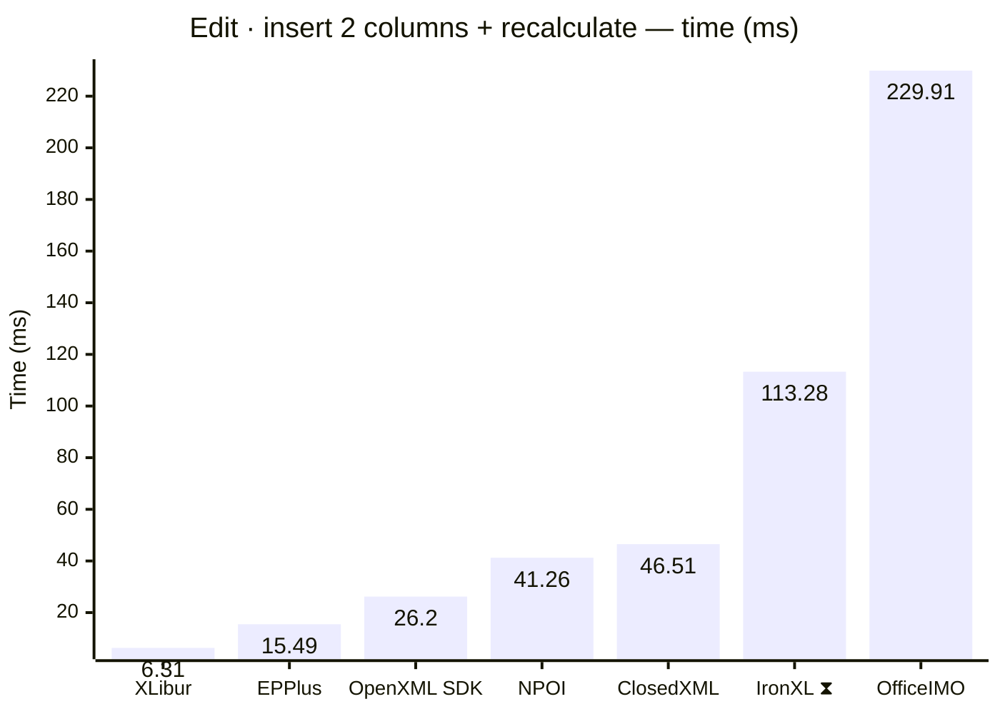
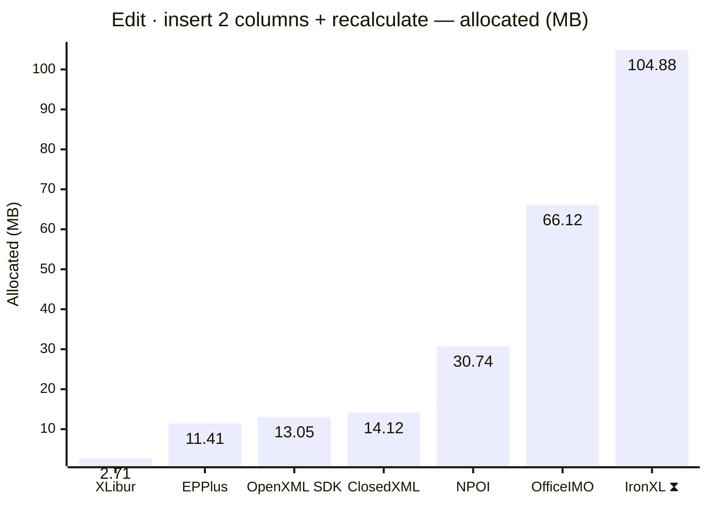

<style>
  .main-content { max-width: 90% !important; padding-left: 2rem !important; padding-right: 2rem !important; }
</style>
<!-- Generated by XLBench. Do not edit by hand; re-run scripts/run-benchmarks.ps1. -->
# XLBench Results

Each section below embeds the full BenchmarkDotNet environment block (OS, CPU,
.NET SDK and runtime). Timings are hardware-specific; treat the allocation/GC
columns as the most portable signal across machines. Regenerate locally with
`scripts/run-benchmarks.ps1`.

> ⚠️ Generated on a shared GitHub Actions runner — timings are indicative and vary run to run; allocation/memory figures are reliable. Authoritative timings come from a local run: [results.html](results.html).

📈 **[Interactive charts](charts.html)** (GitHub Pages). Static charts and the full tables follow.

Each results table (one per test method) is heat-mapped independently on the Pages site (🟩 best → 🟥 worst).

> ⧗ **Carried over from an earlier run.** The rows and chart points below marked with this symbol were not measured here — the library is commercial and needs a licence key this run did not have — so they are replayed from `snapshots/`. Compare them as indicative rather than like-for-like, and see the repository README for how to refresh a snapshot.
>
> - **IronXL** 2026.8.1, Job-HTCPYF job, captured 2026-08-03 on different hardware — Windows 11 (10.0.22631.6199/23H2/2023Update/SunValley3), AMD Ryzen 9 5950X 16-Core Processor.

## Libraries under test

| Library | Version | Source |
| --- | --- | --- |
| ClosedXML | 0.105.1 | this run |
| EPPlus | 8.7.1 | this run |
| OpenXML SDK | 3.5.1 | this run |
| NPOI | 2.8.1 | this run |
| MiniExcel | 1.46.0 | this run |
| Sylvan | 0.5.8 | this run |
| XLibur | 0.630.1-rc.18 | this run |
| OfficeIMO | 3.4.4 | this run |
| IronXL ⧗ | 2026.8.1 | snapshot (2026.8.1, Job-HTCPYF, captured 2026-08-03) |

## Comparison charts

_Lower is better. Charts render in the GitHub file view; the Pages site has interactive versions._




















## Detailed results


```

BenchmarkDotNet v0.15.8, Linux Ubuntu 24.04.5 LTS (Noble Numbat)
AMD EPYC 9V45 3.98GHz, 1 CPU, 4 logical and 2 physical cores
.NET SDK 10.0.401
  [Host]   : .NET 10.0.12 (10.0.12, 10.0.1226.42308), X64 RyuJIT x86-64-v4
  ShortRun : .NET 10.0.12 (10.0.12, 10.0.1226.42308), X64 RyuJIT x86-64-v4

Job=ShortRun  IterationCount=3  LaunchCount=1  
WarmupCount=3  

```

### Read · open + set properties + save

| Library     | Type                      | Method                      | Mean          | Error         | StdDev      | Median        | Gen0       | Gen1       | Gen2      | Allocated  |
|------------ |-------------------------- |---------------------------- |--------------:|--------------:|------------:|--------------:|-----------:|-----------:|----------:|-----------:|
| OpenXML SDK | OpenXmlReadBenchmarks     | OpenAmendPropertiesAndSave  |     0.2354 ms |     1.2475 ms |   0.0684 ms |     0.2073 ms |    28.8086 |    19.5313 |   15.1367 |    0.34 MB |
| XLibur      | XLiburReadBenchmarks      | OpenAmendPropertiesAndSave  |     4.5781 ms |     8.3787 ms |   0.4593 ms |     4.5211 ms |    62.5000 |    31.2500 |         - |    1.35 MB |
| NPOI        | NpoiReadBenchmarks        | OpenAmendPropertiesAndSave  |     9.0634 ms |     6.1619 ms |   0.3378 ms |     9.0940 ms |    62.5000 |    31.2500 |         - |    1.89 MB |
| OfficeIMO   | OfficeImoReadBenchmarks   | OpenAmendPropertiesAndSave  |    19.3498 ms |     3.7684 ms |   0.2066 ms |    19.3908 ms |   562.5000 |   437.5000 |  406.2500 |    6.57 MB |
| EPPlus      | EpPlusReadBenchmarks      | OpenAmendPropertiesAndSave  |    31.4424 ms |    44.3671 ms |   2.4319 ms |    31.7859 ms |  1000.0000 |  1000.0000 | 1000.0000 |   13.87 MB |
| ClosedXML   | ClosedXmlReadBenchmarks   | OpenAmendPropertiesAndSave  |    32.3041 ms |    53.6273 ms |   2.9395 ms |    32.1907 ms |   750.0000 |   375.0000 |         - |   13.17 MB |
| IronXL ⧗ | IronXlReadBenchmarks | OpenAmendPropertiesAndSave | 208.746 ms | 155.7570 ms | 92.6885 ms | 168.705 ms | 9000.0000 | 2000.0000 | - | 152.81 MB |

### Read · open + read all cells

| Library     | Type                      | Method                      | Mean          | Error         | StdDev      | Median        | Gen0       | Gen1       | Gen2      | Allocated  |
|------------ |-------------------------- |---------------------------- |--------------:|--------------:|------------:|--------------:|-----------:|-----------:|----------:|-----------:|
| Sylvan      | SylvanReadBenchmarks      | OpenAndReadAll              |   223.4091 ms |    27.9319 ms |   1.5310 ms |   223.5487 ms |  1666.6667 |  1000.0000 |  333.3333 |   25.28 MB |
| MiniExcel   | MiniExcelReadBenchmarks   | OpenAndReadAll              |   589.4223 ms |    88.5628 ms |   4.8544 ms |   586.7983 ms | 50000.0000 |  3000.0000 |         - |  805.89 MB |
| XLibur      | XLiburReadBenchmarks      | OpenAndReadAll              |   670.0245 ms |   228.7258 ms |  12.5372 ms |   669.7490 ms |  8000.0000 |  5000.0000 | 1000.0000 |  135.95 MB |
| EPPlus      | EpPlusReadBenchmarks      | OpenAndReadAll              |   987.4438 ms |   351.9108 ms |  19.2894 ms |   982.1572 ms | 49000.0000 | 14000.0000 | 7000.0000 |  924.42 MB |
| OpenXML SDK | OpenXmlReadBenchmarks     | OpenAndReadAll              |   996.6794 ms |   399.3537 ms |  21.8899 ms |   998.5702 ms | 40000.0000 |  6000.0000 | 1000.0000 |  627.82 MB |
| NPOI        | NpoiReadBenchmarks        | OpenAndReadAll              | 2,630.8602 ms | 3,300.4012 ms | 180.9061 ms | 2,727.3238 ms | 67000.0000 | 62000.0000 | 6000.0000 | 1075.67 MB |
| OfficeIMO   | OfficeImoReadBenchmarks   | OpenAndReadAll              | 2,660.1012 ms | 1,446.8457 ms |  79.3065 ms | 2,631.9113 ms | 53000.0000 | 39000.0000 | 5000.0000 |  823.25 MB |
| ClosedXML   | ClosedXmlReadBenchmarks   | OpenAndReadAll              | 6,260.3870 ms | 2,301.2960 ms | 126.1418 ms | 6,253.5119 ms | 60000.0000 | 24000.0000 | 4000.0000 | 1073.97 MB |
| IronXL ⧗ | IronXlReadBenchmarks | OpenAndReadAll | 9,318.107 ms | 477.3336 ms | 315.7266 ms | 9,377.407 ms | 393000.0000 | 202000.0000 | 10000.0000 | 6333.04 MB |

### Write · create + save

| Library     | Type                      | Method                      | Mean          | Error         | StdDev      | Median        | Gen0       | Gen1       | Gen2      | Allocated  |
|------------ |-------------------------- |---------------------------- |--------------:|--------------:|------------:|--------------:|-----------:|-----------:|----------:|-----------:|
| Sylvan      | SylvanWriteBenchmarks     | CreateAndSave               |    28.7499 ms |    44.9495 ms |   2.4638 ms |    27.3537 ms |  1718.7500 |  1625.0000 | 1468.7500 |   13.27 MB |
| MiniExcel   | MiniExcelWriteBenchmarks  | CreateAndSave               |    48.8237 ms |     9.9998 ms |   0.5481 ms |    48.5632 ms |  5727.2727 |  1727.2727 | 1636.3636 |   84.59 MB |
| OpenXML SDK | OpenXmlWriteBenchmarks    | CreateAndSave               |   122.1238 ms |    49.0671 ms |   2.6895 ms |   120.7218 ms |  8750.0000 |  2000.0000 | 2000.0000 |  134.19 MB |
| XLibur      | XLiburWriteBenchmarks     | CreateAndSave               |   241.0150 ms |   314.7924 ms |  17.2548 ms |   238.1581 ms |  3000.0000 |  2000.0000 | 2000.0000 |   60.19 MB |
| ClosedXML   | ClosedXmlWriteBenchmarks  | CreateAndSave               |   352.1213 ms |   331.3112 ms |  18.1603 ms |   351.7457 ms | 11000.0000 |  6000.0000 | 3000.0000 |  181.09 MB |
| EPPlus      | EpPlusWriteBenchmarks     | CreateAndSave               |   400.4104 ms |    52.7684 ms |   2.8924 ms |   399.9745 ms | 20000.0000 |  9000.0000 | 3000.0000 |  322.56 MB |
| NPOI        | NpoiWriteBenchmarks       | CreateAndSave               |   657.6021 ms |   136.7720 ms |   7.4969 ms |   656.3545 ms | 16000.0000 | 12000.0000 | 3000.0000 |  246.27 MB |
| OfficeIMO   | OfficeImoWriteBenchmarks  | CreateAndSave               |   754.9506 ms |   736.7663 ms |  40.3846 ms |   733.8591 ms | 19000.0000 | 14000.0000 | 3000.0000 |   360.9 MB |
| IronXL ⧗ | IronXlWriteBenchmarks | CreateAndSave | 943.137 ms | 18.5191 ms | 11.0204 ms | 938.999 ms | 48000.0000 | 16000.0000 | 3000.0000 | 797.63 MB |

### Report · data + conditional formatting + chart

| Library     | Type                      | Method                      | Mean          | Error         | StdDev      | Median        | Gen0       | Gen1       | Gen2      | Allocated  |
|------------ |-------------------------- |---------------------------- |--------------:|--------------:|------------:|--------------:|-----------:|-----------:|----------:|-----------:|
| OpenXML SDK | OpenXmlReportBenchmarks   | CreateStockReport           |     6.2246 ms |     1.0394 ms |   0.0570 ms |     6.1967 ms |   375.0000 |   359.3750 |  187.5000 |    4.92 MB |
| XLibur      | XLiburReportBenchmarks    | CreateStockReport           |     7.0218 ms |     2.3680 ms |   0.1298 ms |     7.0599 ms |   187.5000 |   187.5000 |  187.5000 |    3.35 MB |
| ClosedXML   | ClosedXmlReportBenchmarks | CreateStockReport           |    13.8281 ms |    10.8871 ms |   0.5968 ms |    13.4888 ms |   484.3750 |   359.3750 |  187.5000 |    8.01 MB |
| NPOI        | NpoiReportBenchmarks      | CreateStockReport           |    30.1014 ms |     5.2009 ms |   0.2851 ms |    30.2290 ms |   857.1429 |   714.2857 |  428.5714 |   16.48 MB |
| EPPlus      | EpPlusReportBenchmarks    | CreateStockReport           |    30.7284 ms |   131.8812 ms |   7.2289 ms |    33.9799 ms |  1000.0000 |  1000.0000 | 1000.0000 |   14.07 MB |
| OfficeIMO   | OfficeImoReportBenchmarks | CreateStockReport           |   158.5055 ms |    27.5568 ms |   1.5105 ms |   158.0203 ms | 57000.0000 |  2000.0000 |  666.6667 |  904.36 MB |
| IronXL ⧗ | IronXlReportBenchmarks | CreateStockReport | 387.849 ms | 36.5456 ms | 24.1726 ms | 384.092 ms | 14000.0000 | 3000.0000 | - | 237.38 MB |

### Edit · delete rows + set column + recalculate

| Library     | Type                      | Method                      | Mean          | Error         | StdDev      | Median        | Gen0       | Gen1       | Gen2      | Allocated  |
|------------ |-------------------------- |---------------------------- |--------------:|--------------:|------------:|--------------:|-----------:|-----------:|----------:|-----------:|
| XLibur      | XLiburEditBenchmarks      | EditAndRecalculate          |     5.6489 ms |     1.9074 ms |   0.1046 ms |     5.7084 ms |   164.0625 |    78.1250 |         - |    2.68 MB |
| OpenXML SDK | OpenXmlEditBenchmarks     | EditAndRecalculate          |    19.2236 ms |     4.7884 ms |   0.2625 ms |    19.3678 ms |   718.7500 |   656.2500 |  156.2500 |     9.8 MB |
| EPPlus      | EpPlusEditBenchmarks      | EditAndRecalculate          |    80.6277 ms |    20.7300 ms |   1.1363 ms |    80.2883 ms |  9000.0000 |  1166.6667 | 1000.0000 |  142.49 MB |
| ClosedXML   | ClosedXmlEditBenchmarks   | EditAndRecalculate          |   285.4989 ms |    30.8154 ms |   1.6891 ms |   284.8979 ms | 21000.0000 |  1000.0000 |         - |  340.33 MB |
| NPOI        | NpoiEditBenchmarks        | EditAndRecalculate          |   326.4764 ms |    69.5587 ms |   3.8127 ms |   326.4011 ms | 25000.0000 |  1000.0000 |         - |  413.38 MB |
| IronXL ⧗ | IronXlEditBenchmarks | EditAndRecalculate | 1,577.273 ms | 62.9583 ms | 41.6430 ms | 1,583.098 ms | 57000.0000 | 36000.0000 | 15000.0000 | 753.86 MB |
| OfficeIMO   | OfficeImoEditBenchmarks   | EditAndRecalculate          | 2,065.1402 ms |   258.9274 ms |  14.1927 ms | 2,059.7506 ms | 30000.0000 |  1000.0000 |         - |  491.09 MB |

### Edit · insert 2 columns + recalculate

| Library     | Type                      | Method                      | Mean          | Error         | StdDev      | Median        | Gen0       | Gen1       | Gen2      | Allocated  |
|------------ |-------------------------- |---------------------------- |--------------:|--------------:|------------:|--------------:|-----------:|-----------:|----------:|-----------:|
| XLibur      | XLiburInsertBenchmarks    | InsertColumnsAndRecalculate |     6.3056 ms |     0.1574 ms |   0.0086 ms |     6.3087 ms |   164.0625 |    70.3125 |         - |    2.71 MB |
| EPPlus      | EpPlusInsertBenchmarks    | InsertColumnsAndRecalculate |    15.4903 ms |     4.2622 ms |   0.2336 ms |    15.4615 ms |  1000.0000 |  1000.0000 | 1000.0000 |   11.41 MB |
| OpenXML SDK | OpenXmlInsertBenchmarks   | InsertColumnsAndRecalculate |    26.2003 ms |    10.2162 ms |   0.5600 ms |    26.3343 ms |  1000.0000 |   800.0000 |  400.0000 |   13.05 MB |
| NPOI        | NpoiInsertBenchmarks      | InsertColumnsAndRecalculate |    41.2641 ms |    37.6496 ms |   2.0637 ms |    40.1466 ms |  2000.0000 |  1333.3333 |  500.0000 |   30.74 MB |
| ClosedXML   | ClosedXmlInsertBenchmarks | InsertColumnsAndRecalculate |    46.5059 ms |   454.9535 ms |  24.9375 ms |    36.6409 ms |   800.0000 |   400.0000 |         - |   14.12 MB |
| IronXL ⧗ | IronXlInsertBenchmarks | InsertColumnsAndRecalculate | 113.284 ms | 41.9750 ms | 27.7638 ms | 97.052 ms | 7000.0000 | 2500.0000 | 750.0000 | 104.88 MB |
| OfficeIMO   | OfficeImoInsertBenchmarks | InsertColumnsAndRecalculate |   229.9072 ms | 1,315.9888 ms |  72.1338 ms |   193.3379 ms |  3000.0000 |  1000.0000 |         - |   66.12 MB |


<script type="module">
  import mermaid from 'https://cdn.jsdelivr.net/npm/mermaid@11/dist/mermaid.esm.min.mjs';
  const blocks = document.querySelectorAll('.language-mermaid');
  blocks.forEach(el => {
    const code = el.querySelector('code') || el;
    const pre = document.createElement('pre');
    pre.className = 'mermaid';
    pre.textContent = code.textContent;
    el.replaceWith(pre);
  });
  if (blocks.length) {
    mermaid.initialize({ startOnLoad: false });
    await mermaid.run({ querySelector: 'pre.mermaid' });
  }
</script>

<script>
(function () {
  const parse = s => { const n = parseFloat(String(s).replace(/,/g, '')); return Number.isFinite(n) ? n : null; };
  document.querySelectorAll('table').forEach(table => {
    if (!table.tHead || !table.tBodies[0]) return;
    const heads = [...table.tHead.rows[0].cells].map(c => c.textContent.trim().toLowerCase());
    if (!heads.includes('mean')) return;
    const metricCols = heads.map((h, i) => /^(mean|allocated|gen0|gen1|gen2)$/.test(h) ? i : -1).filter(i => i >= 0);
    const rows = [...table.tBodies[0].rows];
    for (const c of metricCols) {
      const vals = rows.map(r => parse(r.cells[c]?.textContent));
      const nums = vals.filter(v => v !== null);
      if (nums.length < 2) continue;
      const min = Math.min(...nums), max = Math.max(...nums);
      if (max === min) continue;
      rows.forEach((r, i) => {
        const v = vals[i]; if (v === null) return;
        const ratio = (v - min) / (max - min);
        r.cells[c].style.backgroundColor = `hsla(${120 - 120 * ratio}, 70%, 50%, 0.45)`;
      });
    }
  });
})();
</script>
