<style>
  .main-content { max-width: 90% !important; padding-left: 2rem !important; padding-right: 2rem !important; }
</style>
<!-- Generated by XLBench. Do not edit by hand; re-run scripts/run-benchmarks.ps1. -->
# XLBench Results

Each section below embeds the full BenchmarkDotNet environment block (OS, CPU,
.NET SDK and runtime). Timings are hardware-specific; treat the allocation/GC
columns as the most portable signal across machines. Regenerate locally with
`scripts/run-benchmarks.ps1`.

📈 **[Interactive charts](charts.html)** (GitHub Pages). Static charts and the full tables follow.

Each results table (one per test method) is heat-mapped independently on the Pages site (🟩 best → 🟥 worst).

> ⧗ **Carried over from an earlier run.** The rows and chart points below marked with this symbol were not measured here — the library is commercial and needs a licence key this run did not have — so they are replayed from `snapshots/`. Compare them as indicative rather than like-for-like, and see the repository README for how to refresh a snapshot.
>
> - **IronXL** 2026.8.1, Job-HTCPYF job, captured 2026-08-03 on same hardware as this run.

## Libraries under test

| Library | Version | Source |
| --- | --- | --- |
| ClosedXML | 0.105.1 | this run |
| EPPlus | 8.7.2 | this run |
| OpenXML SDK | 3.5.1 | this run |
| NPOI | 2.8.1 | this run |
| MiniExcel | 1.46.0 | this run |
| Sylvan | 0.5.8 | this run |
| XLibur | 0.720.0 | this run |
| OfficeIMO | 3.5.1 | this run |
| Telerik | 2026.3.1014.100 | this run |
| IronXL ⧗ | 2026.8.1 | snapshot (2026.8.1, Job-HTCPYF, captured 2026-08-03) |

## Comparison charts

_Lower is better. Charts render in the GitHub file view; the Pages site has interactive versions._

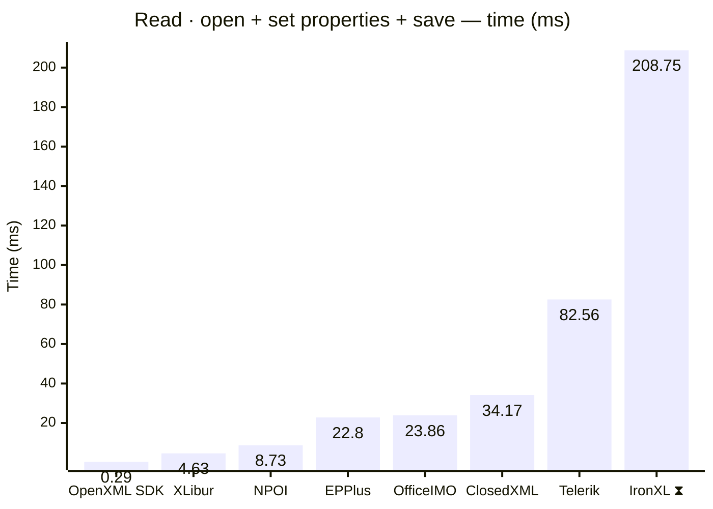

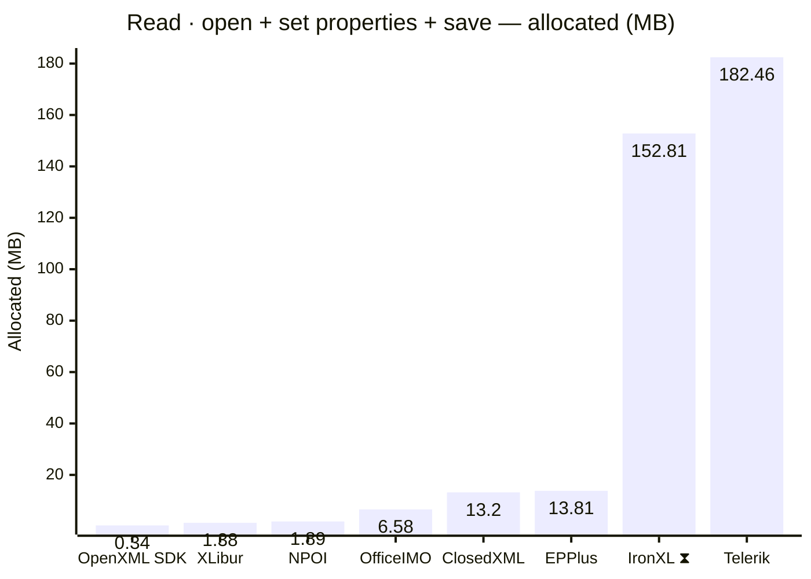

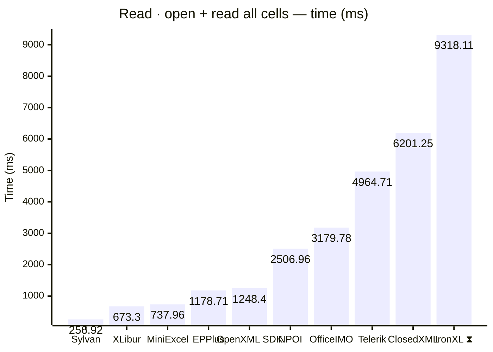

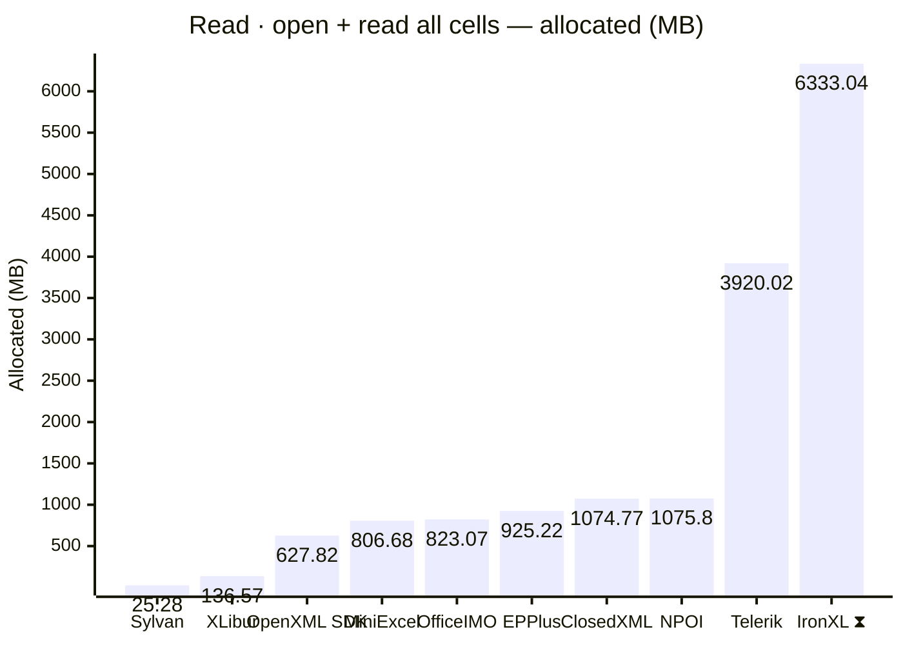

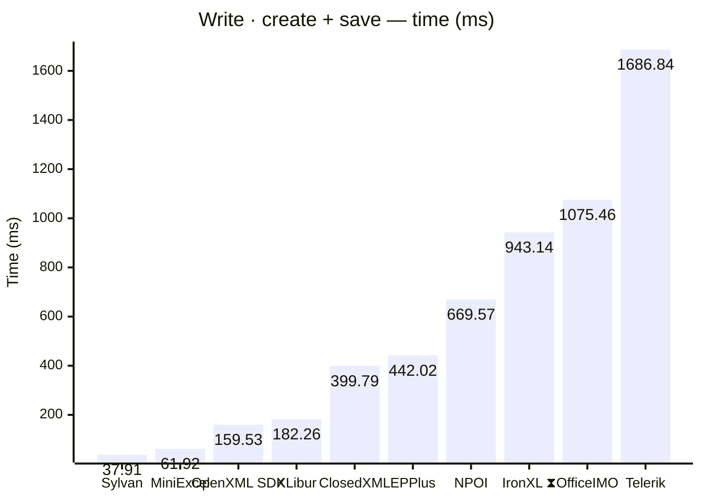

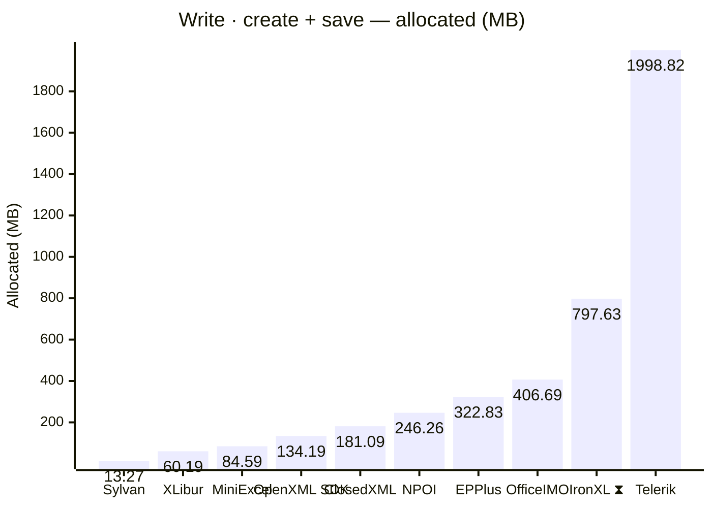

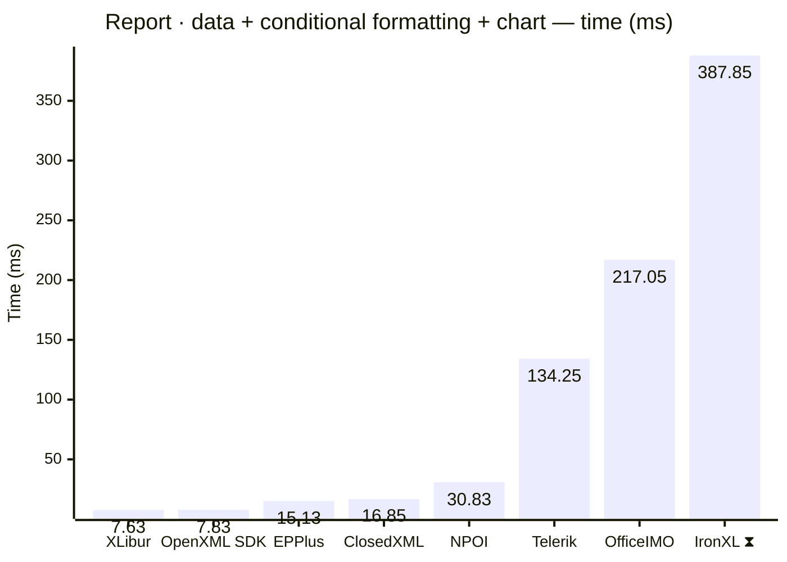

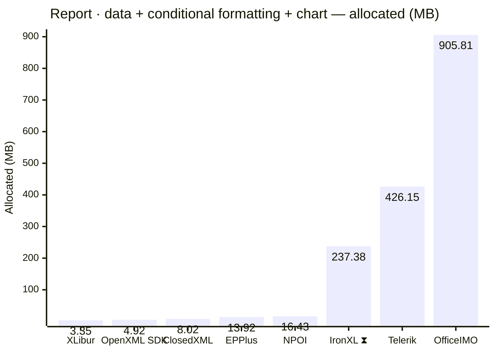

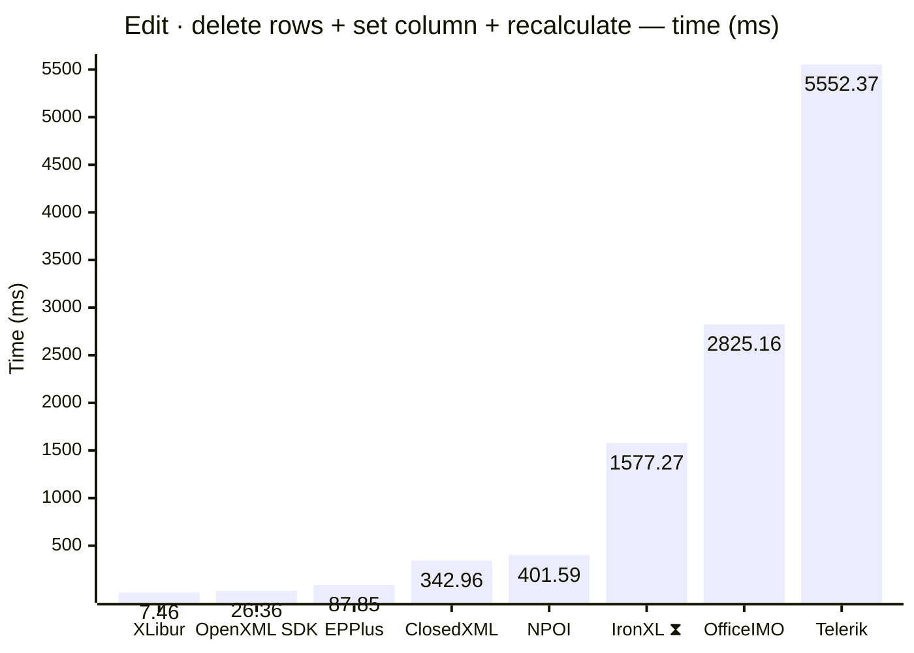

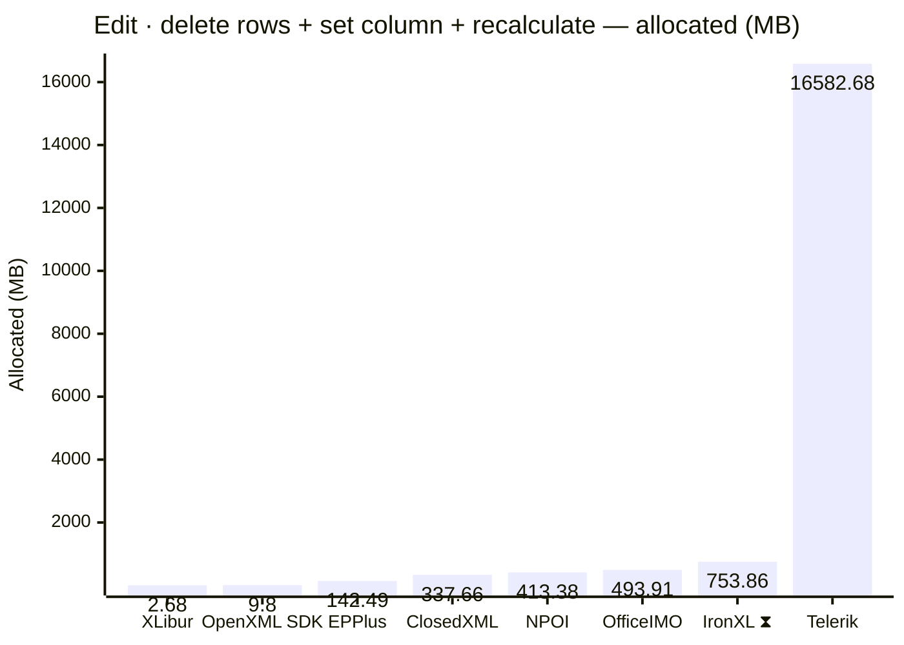

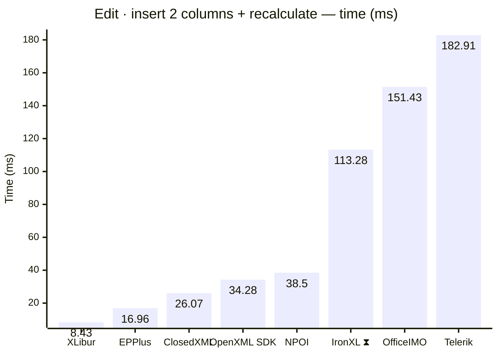

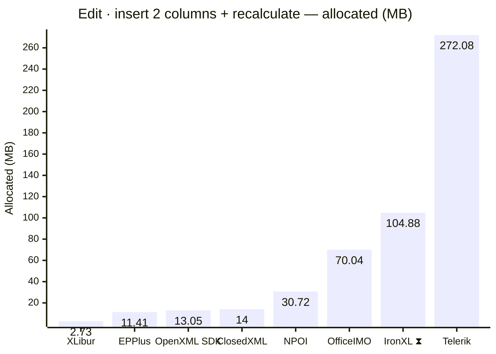

## Detailed results


```

BenchmarkDotNet v0.15.8, Windows 11 (10.0.22631.6199/23H2/2023Update/SunValley3)
AMD Ryzen 9 5950X 3.40GHz, 1 CPU, 32 logical and 16 physical cores
.NET SDK 10.0.402
  [Host]     : .NET 10.0.13 (10.0.13, 10.0.1326.50504), X64 RyuJIT x86-64-v3
  DefaultJob : .NET 10.0.13 (10.0.13, 10.0.1326.50504), X64 RyuJIT x86-64-v3


```

### Read · open + set properties + save

| Library     | Type                      | Method                      | Mean          | Error      | StdDev     | Median        | Gen0         | Gen1        | Gen2       | Allocated   |
|------------ |-------------------------- |---------------------------- |--------------:|-----------:|-----------:|--------------:|-------------:|------------:|-----------:|------------:|
| OpenXML SDK | OpenXmlReadBenchmarks     | OpenAmendPropertiesAndSave  |     0.2926 ms |  0.0058 ms |  0.0111 ms |     0.2915 ms |      29.2969 |     19.5313 |    15.6250 |     0.34 MB |
| XLibur      | XLiburReadBenchmarks      | OpenAmendPropertiesAndSave  |     4.6308 ms |  0.0892 ms |  0.1653 ms |     4.5842 ms |      62.5000 |     31.2500 |          - |     1.38 MB |
| NPOI        | NpoiReadBenchmarks        | OpenAmendPropertiesAndSave  |     8.7341 ms |  0.1056 ms |  0.0988 ms |     8.7379 ms |      62.5000 |     31.2500 |          - |     1.89 MB |
| EPPlus      | EpPlusReadBenchmarks      | OpenAmendPropertiesAndSave  |    22.7969 ms |  0.4495 ms |  0.7753 ms |    22.6981 ms |    1000.0000 |   1000.0000 |  1000.0000 |    13.81 MB |
| OfficeIMO   | OfficeImoReadBenchmarks   | OpenAmendPropertiesAndSave  |    23.8619 ms |  0.2369 ms |  0.1978 ms |    23.8644 ms |     562.5000 |    437.5000 |   406.2500 |     6.58 MB |
| ClosedXML   | ClosedXmlReadBenchmarks   | OpenAmendPropertiesAndSave  |    34.1701 ms |  0.4993 ms |  0.4671 ms |    34.0395 ms |     666.6667 |    333.3333 |          - |     13.2 MB |
| Telerik     | TelerikReadBenchmarks     | OpenAmendPropertiesAndSave  |    82.5582 ms |  1.6387 ms |  2.9965 ms |    82.0035 ms |   10666.6667 |   1000.0000 |   666.6667 |   182.46 MB |
| IronXL ⧗ | IronXlReadBenchmarks | OpenAmendPropertiesAndSave | 208.746 ms | 155.7570 ms | 92.6885 ms | 168.705 ms | 9000.0000 | 2000.0000 | - | 152.81 MB |

### Read · open + read all cells

| Library     | Type                      | Method                      | Mean          | Error      | StdDev     | Median        | Gen0         | Gen1        | Gen2       | Allocated   |
|------------ |-------------------------- |---------------------------- |--------------:|-----------:|-----------:|--------------:|-------------:|------------:|-----------:|------------:|
| Sylvan      | SylvanReadBenchmarks      | OpenAndReadAll              |   256.9186 ms |  4.6137 ms |  4.0899 ms |   255.8213 ms |    1000.0000 |    500.0000 |          - |    25.28 MB |
| XLibur      | XLiburReadBenchmarks      | OpenAndReadAll              |   673.2967 ms | 12.9889 ms | 16.8893 ms |   670.9027 ms |    8000.0000 |   5000.0000 |  1000.0000 |   136.57 MB |
| MiniExcel   | MiniExcelReadBenchmarks   | OpenAndReadAll              |   737.9555 ms |  9.2224 ms |  8.6266 ms |   737.0013 ms |   50000.0000 |   3000.0000 |          - |   806.68 MB |
| EPPlus      | EpPlusReadBenchmarks      | OpenAndReadAll              | 1,178.7093 ms | 23.5667 ms | 25.2161 ms | 1,174.6985 ms |   49000.0000 |  14000.0000 |  7000.0000 |   925.22 MB |
| OpenXML SDK | OpenXmlReadBenchmarks     | OpenAndReadAll              | 1,248.4018 ms | 14.1330 ms | 12.5286 ms | 1,251.8310 ms |   40000.0000 |   6000.0000 |  1000.0000 |   627.82 MB |
| NPOI        | NpoiReadBenchmarks        | OpenAndReadAll              | 2,506.9616 ms | 42.0704 ms | 39.3527 ms | 2,511.5903 ms |   68000.0000 |  62000.0000 |  6000.0000 |   1075.8 MB |
| OfficeIMO   | OfficeImoReadBenchmarks   | OpenAndReadAll              | 3,179.7789 ms | 36.2862 ms | 33.9421 ms | 3,182.5364 ms |   52000.0000 |  39000.0000 |  5000.0000 |   823.07 MB |
| Telerik     | TelerikReadBenchmarks     | OpenAndReadAll              | 4,964.7144 ms | 83.5454 ms | 78.1484 ms | 4,964.9153 ms |  238000.0000 |  46000.0000 |  6000.0000 |  3920.02 MB |
| ClosedXML   | ClosedXmlReadBenchmarks   | OpenAndReadAll              | 6,201.2487 ms | 45.6314 ms | 35.6260 ms | 6,206.6305 ms |   60000.0000 |  24000.0000 |  4000.0000 |  1074.77 MB |
| IronXL ⧗ | IronXlReadBenchmarks | OpenAndReadAll | 9,318.107 ms | 477.3336 ms | 315.7266 ms | 9,377.407 ms | 393000.0000 | 202000.0000 | 10000.0000 | 6333.04 MB |

### Write · create + save

| Library     | Type                      | Method                      | Mean          | Error      | StdDev     | Median        | Gen0         | Gen1        | Gen2       | Allocated   |
|------------ |-------------------------- |---------------------------- |--------------:|-----------:|-----------:|--------------:|-------------:|------------:|-----------:|------------:|
| Sylvan      | SylvanWriteBenchmarks     | CreateAndSave               |    37.9130 ms |  0.7457 ms |  0.6611 ms |    37.7288 ms |    1714.2857 |   1642.8571 |  1500.0000 |    13.27 MB |
| MiniExcel   | MiniExcelWriteBenchmarks  | CreateAndSave               |    61.9204 ms |  1.1986 ms |  1.2825 ms |    62.1425 ms |    5111.1111 |   1222.2222 |  1111.1111 |    84.59 MB |
| OpenXML SDK | OpenXmlWriteBenchmarks    | CreateAndSave               |   159.5254 ms |  2.7538 ms |  2.2996 ms |   158.6992 ms |    8000.0000 |   2000.0000 |  2000.0000 |   134.19 MB |
| XLibur      | XLiburWriteBenchmarks     | CreateAndSave               |   182.2573 ms |  3.2686 ms |  5.1843 ms |   181.1901 ms |    3000.0000 |   2000.0000 |  2000.0000 |    60.19 MB |
| ClosedXML   | ClosedXmlWriteBenchmarks  | CreateAndSave               |   399.7937 ms |  7.8635 ms |  9.9448 ms |   401.5488 ms |   10000.0000 |   5000.0000 |  2000.0000 |   181.09 MB |
| EPPlus      | EpPlusWriteBenchmarks     | CreateAndSave               |   442.0243 ms |  8.4003 ms |  8.2502 ms |   441.7482 ms |   20000.0000 |   9000.0000 |  3000.0000 |   322.83 MB |
| NPOI        | NpoiWriteBenchmarks       | CreateAndSave               |   669.5707 ms | 11.8549 ms | 11.0891 ms |   667.5664 ms |   16000.0000 |  12000.0000 |  3000.0000 |   246.26 MB |
| IronXL ⧗ | IronXlWriteBenchmarks | CreateAndSave | 943.137 ms | 18.5191 ms | 11.0204 ms | 938.999 ms | 48000.0000 | 16000.0000 | 3000.0000 | 797.63 MB |
| OfficeIMO   | OfficeImoWriteBenchmarks  | CreateAndSave               | 1,075.4625 ms | 18.5655 ms | 17.3662 ms | 1,073.5850 ms |   22000.0000 |  16000.0000 |  3000.0000 |   406.69 MB |
| Telerik     | TelerikWriteBenchmarks    | CreateAndSave               | 1,686.8381 ms | 22.7016 ms | 21.2351 ms | 1,686.0820 ms |  124000.0000 |  14000.0000 |  5000.0000 |  1998.82 MB |

### Report · data + conditional formatting + chart

| Library     | Type                      | Method                      | Mean          | Error      | StdDev     | Median        | Gen0         | Gen1        | Gen2       | Allocated   |
|------------ |-------------------------- |---------------------------- |--------------:|-----------:|-----------:|--------------:|-------------:|------------:|-----------:|------------:|
| XLibur      | XLiburReportBenchmarks    | CreateStockReport           |     7.6348 ms |  0.1252 ms |  0.1230 ms |     7.6160 ms |     187.5000 |    187.5000 |   187.5000 |     3.35 MB |
| OpenXML SDK | OpenXmlReportBenchmarks   | CreateStockReport           |     7.8292 ms |  0.0629 ms |  0.0491 ms |     7.8259 ms |     375.0000 |    359.3750 |   187.5000 |     4.92 MB |
| EPPlus      | EpPlusReportBenchmarks    | CreateStockReport           |    15.1308 ms |  0.2948 ms |  0.2895 ms |    15.1836 ms |    1000.0000 |   1000.0000 |  1000.0000 |    13.92 MB |
| ClosedXML   | ClosedXmlReportBenchmarks | CreateStockReport           |    16.8519 ms |  0.3229 ms |  0.3589 ms |    16.8029 ms |     468.7500 |    187.5000 |    31.2500 |     8.02 MB |
| NPOI        | NpoiReportBenchmarks      | CreateStockReport           |    30.8314 ms |  0.3676 ms |  0.3439 ms |    30.7889 ms |     875.0000 |    750.0000 |   375.0000 |    16.43 MB |
| Telerik     | TelerikReportBenchmarks   | CreateStockReport           |   134.2529 ms |  2.7634 ms |  8.0172 ms |   134.9012 ms |   28000.0000 |   8000.0000 |  3000.0000 |   426.15 MB |
| OfficeIMO   | OfficeImoReportBenchmarks | CreateStockReport           |   217.0540 ms |  4.3374 ms |  6.7529 ms |   216.4881 ms |   56000.0000 |   2000.0000 |          - |   905.81 MB |
| IronXL ⧗ | IronXlReportBenchmarks | CreateStockReport | 387.849 ms | 36.5456 ms | 24.1726 ms | 384.092 ms | 14000.0000 | 3000.0000 | - | 237.38 MB |

### Edit · delete rows + set column + recalculate

| Library     | Type                      | Method                      | Mean          | Error      | StdDev     | Median        | Gen0         | Gen1        | Gen2       | Allocated   |
|------------ |-------------------------- |---------------------------- |--------------:|-----------:|-----------:|--------------:|-------------:|------------:|-----------:|------------:|
| XLibur      | XLiburEditBenchmarks      | EditAndRecalculate          |     7.4603 ms |  0.1461 ms |  0.2096 ms |     7.4278 ms |     156.2500 |     78.1250 |          - |     2.68 MB |
| OpenXML SDK | OpenXmlEditBenchmarks     | EditAndRecalculate          |    26.3641 ms |  0.3538 ms |  0.3136 ms |    26.3757 ms |     718.7500 |    656.2500 |   156.2500 |      9.8 MB |
| EPPlus      | EpPlusEditBenchmarks      | EditAndRecalculate          |    87.8521 ms |  1.2360 ms |  1.1561 ms |    88.0051 ms |    9000.0000 |   1200.0000 |  1000.0000 |   142.49 MB |
| ClosedXML   | ClosedXmlEditBenchmarks   | EditAndRecalculate          |   342.9608 ms |  2.7573 ms |  2.3025 ms |   343.2875 ms |   21000.0000 |   1000.0000 |          - |   337.66 MB |
| NPOI        | NpoiEditBenchmarks        | EditAndRecalculate          |   401.5941 ms |  7.7603 ms |  9.2381 ms |   401.9771 ms |   25000.0000 |   1000.0000 |          - |   413.38 MB |
| IronXL ⧗ | IronXlEditBenchmarks | EditAndRecalculate | 1,577.273 ms | 62.9583 ms | 41.6430 ms | 1,583.098 ms | 57000.0000 | 36000.0000 | 15000.0000 | 753.86 MB |
| OfficeIMO   | OfficeImoEditBenchmarks   | EditAndRecalculate          | 2,825.1643 ms | 28.8395 ms | 26.9765 ms | 2,820.8735 ms |   30000.0000 |   1000.0000 |          - |   493.91 MB |
| Telerik     | TelerikEditBenchmarks     | EditAndRecalculate          | 5,552.3672 ms | 78.1303 ms | 73.0832 ms | 5,543.2924 ms | 1053000.0000 | 248000.0000 | 83000.0000 | 16582.68 MB |

### Edit · insert 2 columns + recalculate

| Library     | Type                      | Method                      | Mean          | Error      | StdDev     | Median        | Gen0         | Gen1        | Gen2       | Allocated   |
|------------ |-------------------------- |---------------------------- |--------------:|-----------:|-----------:|--------------:|-------------:|------------:|-----------:|------------:|
| XLibur      | XLiburInsertBenchmarks    | InsertColumnsAndRecalculate |     8.4332 ms |  0.1449 ms |  0.2031 ms |     8.4202 ms |     156.2500 |     62.5000 |          - |     2.73 MB |
| EPPlus      | EpPlusInsertBenchmarks    | InsertColumnsAndRecalculate |    16.9572 ms |  0.3386 ms |  0.6105 ms |    16.8968 ms |    1000.0000 |   1000.0000 |  1000.0000 |    11.41 MB |
| ClosedXML   | ClosedXmlInsertBenchmarks | InsertColumnsAndRecalculate |    26.0654 ms |  0.5124 ms |  0.8975 ms |    25.8504 ms |     800.0000 |    400.0000 |          - |       14 MB |
| OpenXML SDK | OpenXmlInsertBenchmarks   | InsertColumnsAndRecalculate |    34.2804 ms |  0.5684 ms |  0.4438 ms |    34.4444 ms |    1066.6667 |    933.3333 |   400.0000 |    13.05 MB |
| NPOI        | NpoiInsertBenchmarks      | InsertColumnsAndRecalculate |    38.4964 ms |  0.7134 ms |  1.2495 ms |    38.9943 ms |    2000.0000 |   1400.0000 |   600.0000 |    30.72 MB |
| IronXL ⧗ | IronXlInsertBenchmarks | InsertColumnsAndRecalculate | 113.284 ms | 41.9750 ms | 27.7638 ms | 97.052 ms | 7000.0000 | 2500.0000 | 750.0000 | 104.88 MB |
| OfficeIMO   | OfficeImoInsertBenchmarks | InsertColumnsAndRecalculate |   151.4313 ms |  2.4364 ms |  2.0345 ms |   151.4270 ms |    5000.0000 |   2000.0000 |  1000.0000 |    70.04 MB |
| Telerik     | TelerikInsertBenchmarks   | InsertColumnsAndRecalculate |   182.9093 ms |  3.6406 ms |  9.1336 ms |   179.8170 ms |   17000.0000 |   6000.0000 |  2000.0000 |   272.08 MB |


<script type="module">
  import mermaid from 'https://cdn.jsdelivr.net/npm/mermaid@11/dist/mermaid.esm.min.mjs';
  const blocks = document.querySelectorAll('.language-mermaid');
  blocks.forEach(el => {
    const code = el.querySelector('code') || el;
    const pre = document.createElement('pre');
    pre.className = 'mermaid';
    pre.textContent = code.textContent;
    el.replaceWith(pre);
  });
  if (blocks.length) {
    mermaid.initialize({ startOnLoad: false });
    await mermaid.run({ querySelector: 'pre.mermaid' });
  }
</script>

<script>
(function () {
  const parse = s => { const n = parseFloat(String(s).replace(/,/g, '')); return Number.isFinite(n) ? n : null; };
  document.querySelectorAll('table').forEach(table => {
    if (!table.tHead || !table.tBodies[0]) return;
    const heads = [...table.tHead.rows[0].cells].map(c => c.textContent.trim().toLowerCase());
    if (!heads.includes('mean')) return;
    const metricCols = heads.map((h, i) => /^(mean|allocated|gen0|gen1|gen2)$/.test(h) ? i : -1).filter(i => i >= 0);
    const rows = [...table.tBodies[0].rows];
    for (const c of metricCols) {
      const vals = rows.map(r => parse(r.cells[c]?.textContent));
      const nums = vals.filter(v => v !== null);
      if (nums.length < 2) continue;
      const min = Math.min(...nums), max = Math.max(...nums);
      if (max === min) continue;
      rows.forEach((r, i) => {
        const v = vals[i]; if (v === null) return;
        const ratio = (v - min) / (max - min);
        r.cells[c].style.backgroundColor = `hsla(${120 - 120 * ratio}, 70%, 50%, 0.45)`;
      });
    }
  });
})();
</script>
